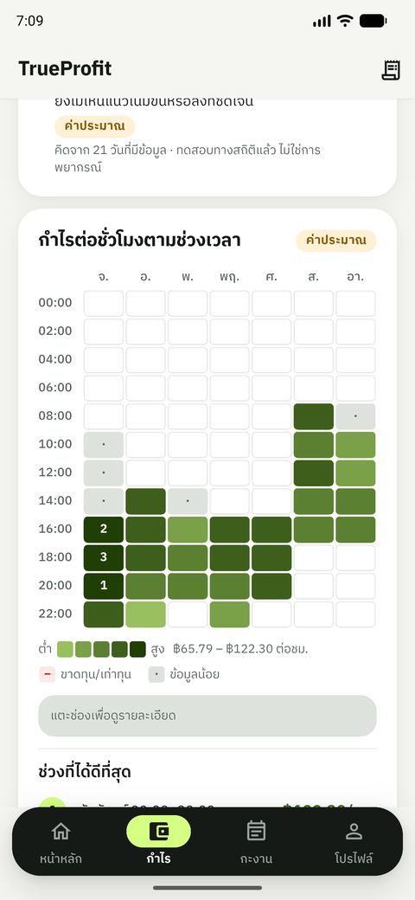
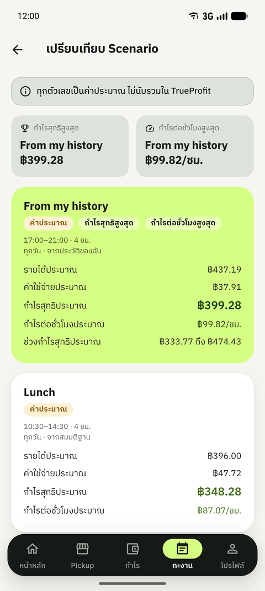
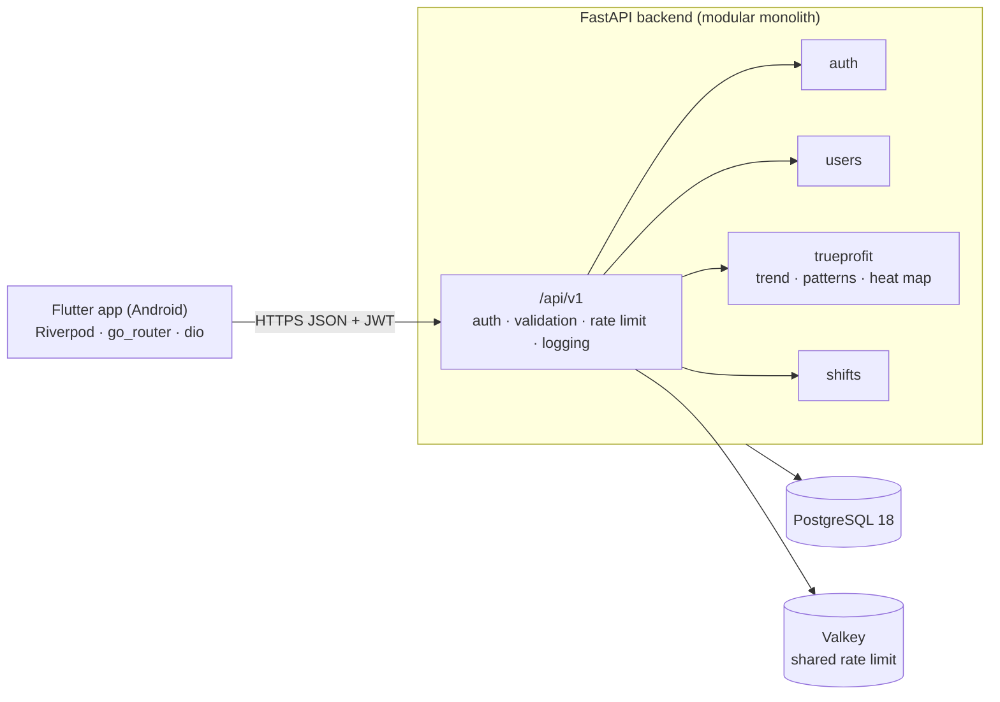

# RiderOS AI

[](https://github.com/Qcutedev/rideros-ai/actions/workflows/ci.yml)


**Grab and LINE MAN help riders take orders and deliver food. RiderOS helps riders understand their own
work, analyze their income, and make better decisions.**

RiderOS is an Android app (Flutter) on a FastAPI + PostgreSQL backend for independent food-delivery riders in
Thailand. The rider logs income, expenses and work sessions (a start/stop timer makes this one tap), and the
app turns that record into answers: what they really earn after costs, which hours pay best, what habits
their work falls into, whether earnings are trending up or down, and what a planned shift is likely to pay.

> **Portfolio project.** I built it on my own as an end-to-end mobile + backend + analytics system. It is
> **not** connected to Grab, LINE MAN or any other platform, and it uses no outside dataset: every number
> comes from what the rider recorded.

---

## Contents
1. [Features](#features)
2. [Screenshots](#screenshots)
3. [Architecture](#architecture)
4. [Tech stack](#tech-stack)
5. [Analytics and how they are checked](#analytics-and-how-they-are-checked)
6. [What I chose not to build](#what-i-chose-not-to-build)
7. [Project structure](#project-structure)
8. [Getting started](#getting-started)
9. [Configuration](#configuration)
10. [Testing](#testing)
11. [API docs](#api-docs)
12. [Deployment](#deployment)
13. [Security](#security)
14. [Performance](#performance)
15. [Limitations](#limitations)
16. [License & credits](#license--credits)

---

## Features

| The rider wants to… | What the app does | Analytics |
|---|---|---|
| **record work with little effort** | Start/stop shift timer on Home: stopping fills in the work session, then opens the income form linked to it (skippable). Income, expense and session forms; a daily net-profit goal with a progress ring. | — |
| **understand their own work** | TrueProfit: real net profit after fuel and wear, profit per hour, day/week/month totals. | K-Means **work patterns** (when, how long), shown only when they pass 3 statistical gates. |
| **analyze their income** | A **profit heat map** of net profit per hour by weekday × 2-hour slot, with the 3 best slots; a weekly trend chart. | Heat map from work sessions; moving average + linear trend, shown only when the slope is significant (p < 0.05). |
| **decide better** | **Shift Simulator**: plan shifts as scenarios and compare estimated revenue, cost and profit before going out. | Deterministic formulas, or "from my history": the rider's own past sessions (P25–P75 range). |

What the app shows follows a few rules:

- Every estimate carries a `ค่าประมาณ` (estimate) badge.
- Money is never calculated by AI. Amounts use `NUMERIC(12,2)` / `Decimal`, and travel as strings in JSON.
- When there is too little data, the app says so. It does not show a weak model result.

## Screenshots

The screenshots come from the Android emulator against the local stack. The rider is a **demo account
with seeded test data**, not real earnings. The UI is in Thai.

The visual design is "Lime Obsidian": an ivory background, cards that alternate sage, teal, mist and
Obsidian, and electric lime for actions and highlights. It has a separate dark theme, and every card tone
is tested for text contrast of at least 4.5:1. Animations stop when the system asks for reduced motion.
The rider illustration on Home is drawn in code. Design spec: [`docs/RIDEROS_UI_DESIGN.md`](docs/RIDEROS_UI_DESIGN.md).

| Home | TrueProfit trend + work patterns | Profit heat map |
|---|---|---|
|  |  |  |

| Shift comparison | Login |
|---|---|
|  |  |

## Architecture

The backend is a modular monolith. The analytics run inside it, on the rider's own rows.



- **Modules** use router → service → repository layers, plus their own schemas and models.
- **Analytics** (scikit-learn K-Means, SciPy regression, the heat map) read only the signed-in rider's
  records. No model is trained offline and no dataset ships with the app.
- **Times** are stored as UTC `timestamptz`. Day boundaries follow the rider's time zone (`Asia/Bangkok` by default).

Full design: [`docs/SYSTEM_ARCHITECTURE.md`](docs/SYSTEM_ARCHITECTURE.md) · database:
[`docs/DATABASE_DESIGN.md`](docs/DATABASE_DESIGN.md).

## Tech stack

| Layer | Tools |
|---|---|
| Mobile | Flutter 3.47 / Dart 3.13, Riverpod 3, go_router 18, dio, freezed, fl_chart, shared_preferences, flutter_secure_storage |
| Backend | Python 3.14, FastAPI, SQLAlchemy 2 (async, asyncpg), Alembic, Argon2id, PyJWT, structlog, `limits` |
| Data | PostgreSQL 18 (PostGIS image: older migrations create geography columns), Valkey (rate-limit store) |
| Analytics | scikit-learn (K-Means, silhouette, ARI), SciPy (linear regression), NumPy |
| Tooling | uv (lockfiles), ruff, pytest, Docker Compose, Caddy, GitHub Actions, gitleaks |

## Analytics and how they are checked

Every number below comes from an actual run. Each one links to the report or code it came from.

### Work patterns (K-Means), trend and profit heat map

K-Means has no labels, so I measured it on **synthetic riders whose real groups are known**:
6 scenarios × 3 data sizes × 30 runs. This benchmark is not accuracy on real riders.

A pattern is shown only when it passes all 3 gates:

1. Silhouette ≥ 0.25.
2. A permutation test: it beats all 39 shuffled datasets (p ≤ 0.025).
3. Bootstrap stability: mean ARI ≥ 0.6.

| Benchmark result | Value |
|---|---|
| False patterns on random / single-habit data | **1.7%** |
| Real patterns detected | **99.2%** |
| Correct number of groups | **94.5%** |

Silhouette alone accepted random data, which is why the permutation test was added. The trend line uses OLS
(`scipy.stats.linregress`) and is drawn only when p < 0.05. On 400 random series with no trend, it reported a
false up/down trend less than 9% of the time. Raw benchmark: `backend/reports/work_patterns_benchmark.json`.

The profit heat map answers "which hours pay best". Income and expense records have a date but no time, so
money reaches an hour only through work sessions: a session's linked records, plus records of the same day
that are not linked to any session (split by session length). Each session spreads its money evenly over
its minutes. A cell shows a value only with at least 2 sessions and 1 hour in it, and the map needs 10
sessions with income in the last 90 days. The colour scale is one hue in 5 steps, checked for monotone
lightness and contrast in both themes; a loss or a thin cell also carries a symbol, so colour is never the
only cue. Method: [`backend/app/modules/profit/heatmap.py`](backend/app/modules/profit/heatmap.py).

## What I chose not to build

The delivery platforms already handle orders, routing and preparation times. RiderOS only does what they do
not: tell the rider about their own work. Earlier versions went further, and I removed those parts:

| Removed | Why |
|---|---|
| **Pickup Intelligence** (2026-11-18): an XGBoost order-to-pickup model trained on the Meituan INFORMS TSL data | The data is from one Chinese city and there is no Thai data to retrain it on. The platforms already show their own preparation-time estimates. |
| **RoadContext** (2026-11-19): a map of rider-reported road incidents, with a MobileNetV3 photo classifier trained on RDD2022 / AlleyFloodNet / Flood10k | Road warnings for other riders do not fit an app about the rider's own work. Without platform integration the app does not know where the rider is going, so it cannot route around an incident either. |
| Shift-earnings ML, LLM chat | No per-shift public data exists to learn from; a paid LLM API is out of scope. |

Both trained models lived in `ml/` and `cv_service/`; their code, tests and reports stay in the Git history.
Neither dataset nor any trained weight was ever committed.

## Project structure

```
backend/      FastAPI app (app/core, app/modules/<auth|users|profit|shifts>), Alembic, tests, perf script
mobile/       Flutter app (lib/features/<feature>/{data,domain,presentation}), unit/widget/integration tests
deploy/       Production stack: compose.prod.yml, Caddyfile, PostGIS image, backup/restore scripts, smoke test
scripts/      regression.ps1: the full local quality gate (lint, tests, coverage, optional E2E)
docs/         Architecture, database, security audit, performance, testing, deployment, project history
.github/      CI workflow
```

Most design documents in `docs/` are written in Thai. This README and the code comments are in English.

## Getting started

**You need:** Docker, Python 3.14 with [uv](https://docs.astral.sh/uv/), and Flutter 3.47 with an Android
emulator.

```bash
# 1. Backend stack: PostgreSQL, Valkey, API
cp .env.example .env               # then replace every CHANGE-ME value
docker compose up --build          # API: http://127.0.0.1:8000/api/v1 · docs: http://127.0.0.1:8000/docs

# 2. Mobile app (the emulator reaches the host at 10.0.2.2:8000 by default)
cd mobile
flutter pub get
flutter run
```

## Configuration

All settings are environment variables. [`.env.example`](.env.example) lists them, with comments.

| Variable | Meaning |
|---|---|
| `POSTGRES_*`, `DATABASE_URL` | Database. Compose builds `DATABASE_URL` for you. |
| `JWT_SECRET` | Required, at least 32 characters. Production refuses to start with a placeholder value. |
| `RATE_LIMIT_STORAGE_URL` | `memory://` (one worker) or `redis://…`. Production with more than 1 worker refuses `memory://`. |
| `TEST_DATABASE_URL` | Throw-away test database. Its name must end in `_test`. |
| `API_BASE_URL` (Flutter `--dart-define`) | API address for the app. Release builds require `https`. |

## Testing

```powershell
.\scripts\regression.ps1          # every gate below; add -E2E for the emulator journey
```

| Suite | Tests | Gate |
|---|---|---|
| Backend (pytest, real PostgreSQL + Valkey) | 382 | coverage of `app/modules` + `app/core`: **98.65%** (gate 96%) |
| Mobile (unit + widget) | 462 | coverage of `lib/` without generated code: **97.18%** (gate 94.7%) |
| E2E (`flutter drive` on the emulator) | 1 journey | checks 17 database values through SQL, then deletes the test account |

The tests include cross-user access checks on every endpoint, token expiry, reuse and forgery, a check that
migrations match the ORM models and roll back cleanly, and the statistical gates of the analytics. CI
([`.github/workflows/ci.yml`](.github/workflows/ci.yml)) runs the same gates on every push, except E2E,
and also runs gitleaks over the full history. See [`docs/TESTING.md`](docs/TESTING.md).

## API docs

FastAPI serves interactive OpenAPI docs at **`/docs`** in development. Production turns them off. All routes
live under `/api/v1`:

| Prefix | Purpose |
|---|---|
| `/auth` | register, login, refresh (rotating tokens with reuse detection), logout, forgot/reset password |
| `/me` | account, rider profile, `DELETE /me` (deletes all of the user's data) |
| `/income`, `/expenses`, `/work-sessions`, `/profit` | TrueProfit records, summaries, trends, work patterns, profit heat map |
| `/shift-scenarios` | scenario CRUD and comparison |
| `/health`, `/ready` | liveness and readiness (database, rate-limit store) |

## Deployment

[`deploy/`](deploy/) holds a production stack:

- **Caddy** handles automatic HTTPS and HSTS, and exposes only `/api/v1/*`.
- **Backend** runs 2 uvicorn workers. It trusts `X-Forwarded-For` only when the request comes from Caddy.
- **Network:** only Caddy publishes a port. Database and Valkey sit on an internal network with no internet
  access.
- **Images:** the PostGIS image builds for both amd64 and arm64.
- **Backups:** a daily `pg_dump` keeps 7 copies. There are restore and restore-test scripts, and a
  12-check smoke test.

I tested the stack locally in Phase 7: smoke test passed (15/15 then; the Pickup and Road checks were removed
with those features), restore drill passed, arm64 images build.
**No public server is running yet.** The runbook is in [`docs/DEPLOYMENT.md`](docs/DEPLOYMENT.md).
For the same reason there is no release APK.

## Security

The audit in [`docs/SECURITY_AUDIT.md`](docs/SECURITY_AUDIT.md) follows the OWASP API Top 10 (2023). Every
claim in it is backed by a test or a code reference.

- **Passwords:** Argon2id, hashed in a threadpool so the event loop never blocks. A blocklist of
  2,114 common passwords. Login fails the same way for an unknown e-mail and for a wrong password.
- **Tokens:** short-lived JWT access tokens. Refresh tokens rotate, are stored hashed, and reuse revokes the
  whole token family. Tokens on the device live in `flutter_secure_storage`.
- **Rate limits:** per user and per IP. The store is shared across workers. If the store fails, requests are
  refused (fail closed).
- **Request bodies:** the API takes JSON only, capped at 256 KB while the body streams in (before
  authentication). The app collects no location and no photos.
- **Scans (Phase 6 audit):** pip-audit / osv-scanner found 0 known vulnerabilities. trivy showed 0 critical and
  0 patched-high issues in the backend image. gitleaks runs in CI over the full history.
- **Production:** forgot-password is turned off until an e-mail provider is configured. The development mode
  only writes the reset link to the log.

## Performance

Measured with [`backend/perf/run.py`](backend/perf/run.py): 200 requests per endpoint, at concurrency 1
and 10, on local Docker. Details: [`docs/PERFORMANCE.md`](docs/PERFORMANCE.md). The run is from Phase 6;
the rows below leave out the Pickup and Road endpoints, which no longer exist.

| Target (p95) | Result |
|---|---|
| CRUD / summary < 300 ms (12 endpoints) | all pass; slowest 149 ms |
| Work patterns (cached) < 500 ms | 14.3 ms (c=1) · 110.5 ms (c=10) |
| Unexpected status codes | 0 of 5,600 requests |
| App cold start (profile build, emulator) | median 1,565 ms |

## Limitations

- **Only as good as the log.** Every analysis reads what the rider recorded. A rider who logs little gets
  "not enough data yet", never a guess.
- **No shift-earnings ML.** There is no per-shift public data (the Thai sources found are aggregates), so the
  Shift Simulator uses transparent formulas and the rider's own history instead of a learned model.
- **Work-pattern accuracy** is measured on synthetic riders only. I have no labelled real data.
- **Not deployed publicly yet.** There is also no iOS build and no e-mail delivery.

## License & credits

- **Code:** [MIT](LICENSE).
- **Credits:** the open-source libraries listed in each lockfile. Earlier versions in the Git history also
  used the Meituan INFORMS TSL data (*this research was supported by data provided by Meituan*), RDD2022,
  AlleyFloodNet, Flood10k and OpenStreetMap; none of them is used or distributed by the current code.
