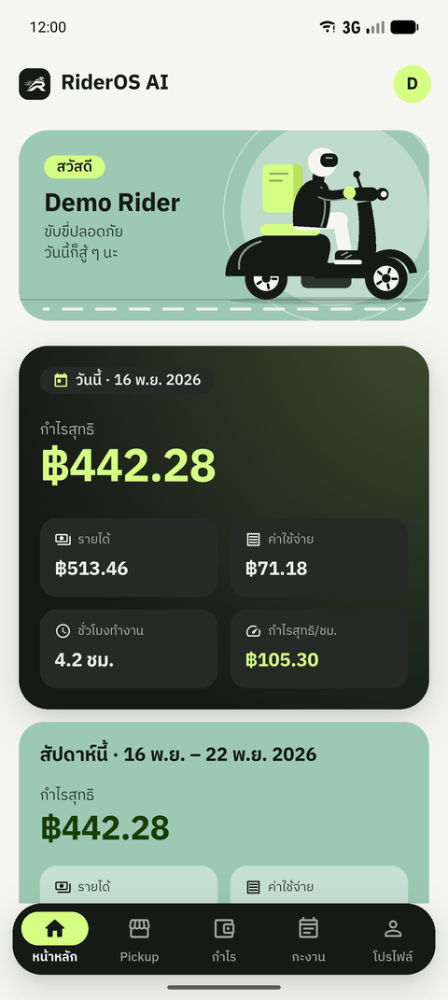
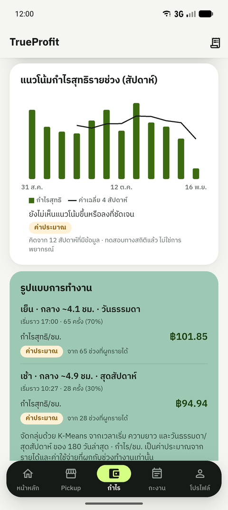
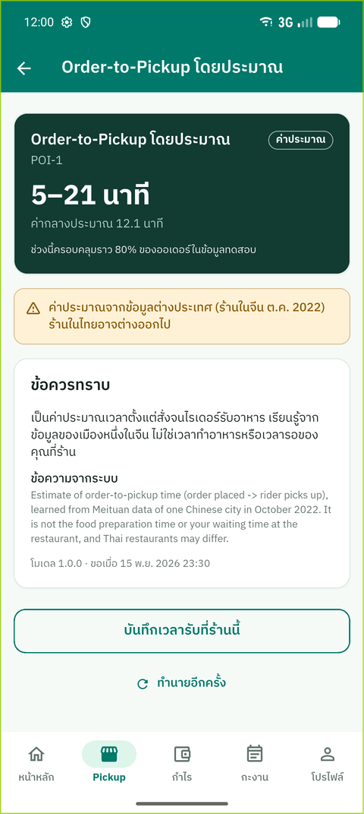
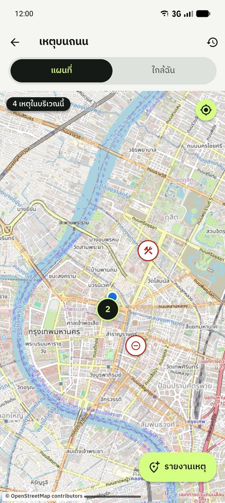
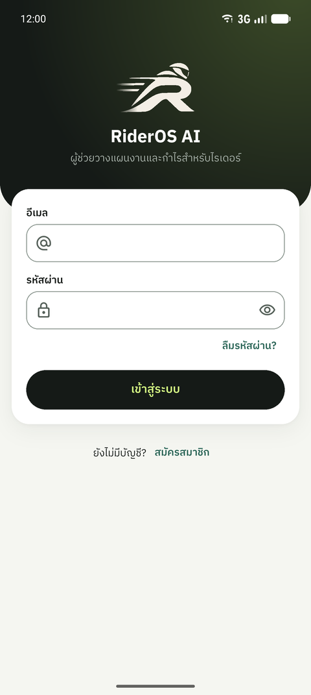
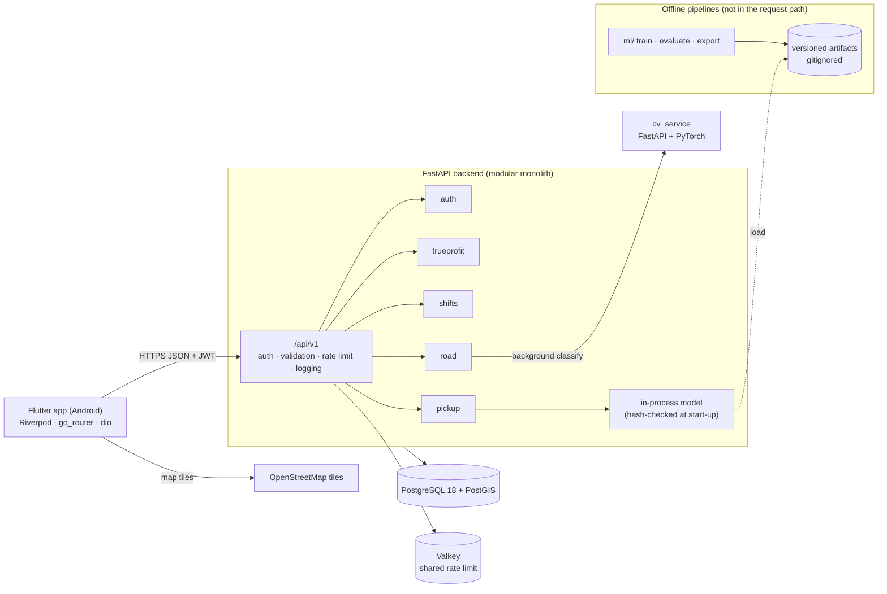

# RiderOS AI

[](https://github.com/Qcutedev/rideros-ai/actions/workflows/ci.yml)


A productivity app for independent food-delivery riders in Thailand. It is an Android app (Flutter) on a
FastAPI + PostGIS backend, with three models I trained myself. The app tracks what a rider actually earns,
estimates how long a restaurant takes from order to pickup, compares planned shifts, and shows road incidents
that other riders report.

> **Portfolio project.** I built it on my own as an end-to-end ML + mobile + backend system. It is **not**
> connected to Grab, LINE MAN or any other platform. Two training datasets are licensed **non-commercial**,
> so the trained models are too (see [Datasets & licenses](#datasets--licenses)).

---

## Contents
1. [Features](#features)
2. [Screenshots](#screenshots)
3. [Architecture](#architecture)
4. [Tech stack](#tech-stack)
5. [AI / ML models and metrics](#ai--ml-models-and-metrics)
6. [Datasets & licenses](#datasets--licenses)
7. [Project structure](#project-structure)
8. [Getting started](#getting-started)
9. [Configuration](#configuration)
10. [Testing](#testing)
11. [API docs](#api-docs)
12. [Deployment](#deployment)
13. [Security](#security)
14. [Performance](#performance)
15. [Limitations](#limitations)
16. [License & credits](#license--credits)

---

## Features

| Module | What it does | AI / analytics |
|---|---|---|
| **TrueProfit** | Log income, expenses and work sessions. See real net profit, profit per hour, and day/week/month totals. Set a daily net-profit goal (progress ring on Home) and time a shift with a start/stop button that fills in the work session. | Moving average + linear trend, shown only when the slope is significant (p < 0.05). K-Means **work patterns**, shown only when they pass 3 statistical gates. A **profit heat map** of net profit per hour by weekday × 2-hour slot, with the 3 best slots. |
| **Pickup Intelligence** | Estimate order-to-pickup minutes for a restaurant, with an 80% interval. Log your own waiting times. | XGBoost regressor + split-conformal interval. Per-restaurant statistics. |
| **Shift Simulator** | Plan shifts as scenarios and compare estimated revenue, cost and profit. | Deterministic formulas. "From my history" mode uses the rider's own past sessions (P25–P75 range). |
| **RoadContext** | Report floods, road damage, closures and obstacles on a map. Duplicate reports merge into one incident. | MobileNetV3 photo classifier. It only **suggests** a category with a confidence score; it never changes a report. |

What the app shows follows a few rules:

- Every estimate carries a `ค่าประมาณ` (estimate) badge.
- Money is never calculated by AI. Amounts use `NUMERIC(12,2)` / `Decimal`, and travel as strings in JSON.
- When there is too little data, the app says so. It does not show a weak model result.

## Screenshots

The screenshots come from the Android emulator against the local stack. The rider is a **demo account
with seeded test data**, not real earnings. The UI is in Thai.

The visual design is "Lime Obsidian": an ivory background, cards that alternate sage, teal, mist and
Obsidian, and electric lime for actions and highlights. It has a separate dark theme, and every card tone
is tested for text contrast of at least 4.5:1. Animations stop when the system asks for reduced motion.
The rider illustration on Home is drawn in code. Design spec: [`docs/RIDEROS_UI_DESIGN.md`](docs/RIDEROS_UI_DESIGN.md).

| Home | TrueProfit trend + work patterns | Pickup estimate |
|---|---|---|
|  |  |  |

| Shift comparison | Road incidents map | Login |
|---|---|---|
|  |  |  |

## Architecture

The backend is a modular monolith. ML training runs offline, and the photo classifier is its own service.



- **Modules** use router → service → repository layers, plus their own schemas and models.
- **Model loading fails closed.** Before `joblib.load`, the registry checks the SHA-256 of every artifact file,
  the feature schema, and the library versions recorded at training time.
- **Times** are stored as UTC `timestamptz`. Day boundaries follow the rider's time zone (`Asia/Bangkok` by default).

Full design: [`docs/SYSTEM_ARCHITECTURE.md`](docs/SYSTEM_ARCHITECTURE.md) · database:
[`docs/DATABASE_DESIGN.md`](docs/DATABASE_DESIGN.md).

## Tech stack

| Layer | Tools |
|---|---|
| Mobile | Flutter 3.47 / Dart 3.13, Riverpod 3, go_router 18, dio, freezed, fl_chart, flutter_map, flutter_secure_storage |
| Backend | Python 3.14, FastAPI, SQLAlchemy 2 (async, asyncpg), Alembic, GeoAlchemy2, Argon2id, PyJWT, structlog, `limits` |
| Data | PostgreSQL 18 + PostGIS, Valkey (rate-limit store) |
| ML | scikit-learn, XGBoost, CatBoost, Optuna, SciPy (`ml/`); PyTorch + torchvision (`cv_service/`) |
| Tooling | uv (lockfiles), ruff, pytest, Docker Compose, Caddy, GitHub Actions, gitleaks |

## AI / ML models and metrics

Every number below comes from an actual run. Each one links to the report it came from.

### 1. Pickup Intelligence: order-to-pickup regression (`ml/`)

The model predicts the **minutes from order creation to rider pickup**. This is not food-preparation time or
rider waiting time; the dataset has no rider-arrival time.

- Data: Meituan INFORMS TSL. The split is temporal: train ≤ 2022-10-22, validation 10-23, test 10-24.
- Leakage controls: a feature guard refuses post-order columns; target encoding is cross-fitted; load features
  only count orders that existed before the order time.
- The model is selected on validation MAE. The test day is scored **once**.

| Model (test day, n = 64,701) | MAE (min) | RMSE | R² |
|---|---|---|---|
| Global median (baseline) | 5.274 | 7.227 | −0.022 |
| Per-restaurant median (baseline) | 4.636 | 6.399 | 0.199 |
| **XGBoost, deployable features (selected)** | **4.509** | **6.061** | **0.281** |
| CatBoost + real-time load features (ablation, not deployable) | 4.479 | 6.011 | 0.293 |

The 80% split-conformal interval covers **81.6%** of test orders (65.1% for restaurants not seen in training).
The gain over the per-restaurant median is modest, **2.7%**. Most of the remaining error comes from things this
data cannot see, such as when the rider arrives. Details: [`ml/README.md`](ml/README.md) and
`ml/reports/pickup_o2p/`.

### 2. RoadContext: photo classifier (`cv_service/`)

MobileNetV3-Large, fine-tuned from ImageNet weights into 3 classes: `flooding`, `road_damage`, `other`.
Splits are leakage-aware: near-duplicates are removed, and video frames are grouped in blocks.

| Test split (n = 1,380) | Value |
|---|---|
| Accuracy | **0.8804** (majority-class baseline 0.2717) |
| Macro-F1 | **0.8755** |
| F1 flooding / road_damage / other | 0.981 / 0.806 / 0.840 |
| Median latency in the container (CPU) | 16.5 ms |

The app shows the suggestion only when confidence is ≥ 0.6. Below that it shows "AI is not sure".
Model card: [`cv_service/reports/1.0.0/model_card.md`](cv_service/reports/1.0.0/model_card.md).

### 3. TrueProfit: work patterns (K-Means), trend and profit heat map

K-Means has no labels, so I measured it on **synthetic riders whose real groups are known**:
6 scenarios × 3 data sizes × 30 runs. This benchmark is not accuracy on real riders.

A pattern is shown only when it passes all 3 gates:

1. Silhouette ≥ 0.25.
2. A permutation test: it beats all 39 shuffled datasets (p ≤ 0.025).
3. Bootstrap stability: mean ARI ≥ 0.6.

| Benchmark result | Value |
|---|---|
| False patterns on random / single-habit data | **1.7%** |
| Real patterns detected | **99.2%** |
| Correct number of groups | **94.5%** |

Silhouette alone accepted random data, which is why the permutation test was added. The trend line uses OLS
(`scipy.stats.linregress`) and is drawn only when p < 0.05. On 400 random series with no trend, it reported a
false up/down trend less than 9% of the time. Raw benchmark: `backend/reports/work_patterns_benchmark.json`.

The profit heat map answers "which hours pay best". Income and expense records have a date but no time, so
money reaches an hour only through work sessions: a session's linked records, plus records of the same day
that are not linked to any session (split by session length). Each session spreads its money evenly over
its minutes. A cell shows a value only with at least 2 sessions and 1 hour in it, and the map needs 10
sessions with income in the last 90 days. The colour scale is one hue in 5 steps, checked for monotone
lightness and contrast in both themes; a loss or a thin cell also carries a symbol, so colour is never the
only cue. Method: [`backend/app/modules/profit/heatmap.py`](backend/app/modules/profit/heatmap.py).

## Datasets & licenses

Datasets and trained weights are **not** in this repository. The pipelines download them and check each file
against a pinned SHA-256.

| Data | Used for | License |
|---|---|---|
| [Meituan INFORMS TSL](https://github.com/meituan/Meituan-INFORMS-TSL-Research-Challenge) (568,546 orders, one Chinese city, Oct 2022) | Pickup model, restaurant statistics | **CC BY-NC 4.0**, no redistribution |
| RDD2022 (China_MotorBike, Czech, India, United_States) | Photo classifier | CC BY 4.0 |
| AlleyFloodNet | Photo classifier | CC BY 4.0 |
| Flood10k | Photo classifier | **CC BY-NC 4.0** |
| torchvision ImageNet-1k weights | Starting weights | ImageNet terms (non-commercial) |
| OpenStreetMap tiles | Map | © OpenStreetMap contributors (ODbL); usage follows the OSM tile policy |

*This research was supported by data provided by Meituan.*

Because of the NC licenses, the trained models and any deployment of this app are **non-commercial**: no ads
and no paid features. Provenance and pins: [`ml/data/SOURCES.md`](ml/data/SOURCES.md),
[`cv_service/data/SOURCES.md`](cv_service/data/SOURCES.md).

## Project structure

```
backend/      FastAPI app (app/core, app/modules/<auth|users|profit|pickup|shifts|road>), Alembic, tests, perf script
ml/           Pickup pipeline: download → validate → build → eda → train → stats (rideros-ml package)
cv_service/   Photo classifier service + training pipeline (download → build → train → evaluate)
mobile/       Flutter app (lib/features/<feature>/{data,domain,presentation}), unit/widget/integration tests
deploy/       Production stack: compose.prod.yml, Caddyfile, PostGIS image, backup/restore scripts, smoke test
scripts/      regression.ps1: the full local quality gate (lint, tests, coverage, optional E2E)
docs/         Architecture, database, dataset analysis, security audit, performance, testing, deployment
.github/      CI workflow
```

Most design documents in `docs/` are written in Thai. This README and the code comments are in English.

## Getting started

**You need:** Docker, Python 3.14 with [uv](https://docs.astral.sh/uv/), and Flutter 3.47 with an Android
emulator.

```bash
# 1. Backend stack: PostGIS, Valkey, API, photo classifier
cp .env.example .env               # then replace every CHANGE-ME value
docker compose up --build          # API: http://127.0.0.1:8000/api/v1 · docs: http://127.0.0.1:8000/docs

# 2. Mobile app (the emulator reaches the host at 10.0.2.2:8000 by default)
cd mobile
flutter pub get
flutter run
```

Without trained artifacts the API still starts. Prediction endpoints answer `503` and `/ready` reports
"not ready". To train the models yourself (you must accept the dataset licenses first):

```bash
cd ml && uv sync && uv run rideros-ml download && uv run rideros-ml validate && uv run rideros-ml build \
      && uv run rideros-ml train && uv run rideros-ml stats         # pickup model (about 30 min on CPU)
cd cv_service && uv sync && uv run python -m training download --alley <AlleyFloodNet zip from Kaggle> \
      && uv run python -m training build && uv run python -m training train && uv run python -m training evaluate
```

## Configuration

All settings are environment variables. [`.env.example`](.env.example) lists them, with comments.

| Variable | Meaning |
|---|---|
| `POSTGRES_*`, `DATABASE_URL` | Database. Compose builds `DATABASE_URL` for you. |
| `JWT_SECRET` | Required, at least 32 characters. Production refuses to start with a placeholder value. |
| `MODEL_DIR`, `ACTIVE_MODEL_NAME`, `ACTIVE_MODEL_VERSION` | Pickup model artifact. Empty `MODEL_DIR` runs without a model. |
| `CV_SERVICE_URL`, `ROAD_IMAGE_DIR` | Photo classifier and photo storage. Leave empty to turn them off. |
| `RATE_LIMIT_STORAGE_URL` | `memory://` (one worker) or `redis://…`. Production with more than 1 worker refuses `memory://`. |
| `TEST_DATABASE_URL` | Throw-away test database. Its name must end in `_test`. |
| `API_BASE_URL` (Flutter `--dart-define`) | API address for the app. Release builds require `https`. |

## Testing

```powershell
.\scripts\regression.ps1          # every gate below; add -E2E for the emulator journey
```

| Suite | Tests | Gate |
|---|---|---|
| Backend (pytest, real PostGIS + Valkey) | 523 | coverage of `app/modules` + `app/core`: **98.18%** (gate 96%) |
| ML pipeline | 134 | ruff + pytest |
| CV service | 38 | ruff + pytest |
| Mobile (unit + widget) | 591 | coverage of `lib/` without generated code: **97.09%** (gate 94.7%) |
| E2E (`flutter drive` on the emulator) | 1 journey | checks 21 database rows through SQL, then deletes the test account |

The tests include cross-user access checks on every endpoint, token expiry, reuse and forgery, a check that
migrations match the ORM models, and train/serve feature parity. CI
([`.github/workflows/ci.yml`](.github/workflows/ci.yml)) runs the same gates on every push, except E2E,
and also runs gitleaks over the full history. See [`docs/TESTING.md`](docs/TESTING.md).

## API docs

FastAPI serves interactive OpenAPI docs at **`/docs`** in development. Production turns them off. All routes
live under `/api/v1`:

| Prefix | Purpose |
|---|---|
| `/auth` | register, login, refresh (rotating tokens with reuse detection), logout, forgot/reset password |
| `/me` | account, rider profile, `DELETE /me` (deletes all of the user's data) |
| `/income`, `/expenses`, `/work-sessions`, `/profit` | TrueProfit records, summaries, trends, work patterns, profit heat map |
| `/pickup` | restaurants, predictions, pickup logs, model info |
| `/shift-scenarios` | scenario CRUD and comparison |
| `/road` | reports (multipart photo upload), incidents by bounding box / nearby, confirmations, status |
| `/health`, `/ready` | liveness and readiness (database, model, rate-limit store) |

## Deployment

[`deploy/`](deploy/) holds a production stack:

- **Caddy** handles automatic HTTPS and HSTS, and exposes only `/api/v1/*`.
- **Backend** runs 2 uvicorn workers. It trusts `X-Forwarded-For` only when the request comes from Caddy.
- **Network:** only Caddy publishes a port. Database, Valkey and the CV service sit on an internal network
  with no internet access.
- **Images:** the PostGIS image builds for both amd64 and arm64.
- **Backups:** a daily `pg_dump` keeps 7 copies. There are restore and restore-test scripts, and a
  15-check smoke test.

I tested the stack locally: smoke test 15/15, restore drill passed, arm64 images build.
**No public server is running yet.** The runbook is in [`docs/DEPLOYMENT.md`](docs/DEPLOYMENT.md).
For the same reason there is no release APK.

## Security

The audit in [`docs/SECURITY_AUDIT.md`](docs/SECURITY_AUDIT.md) follows the OWASP API Top 10 (2023). Every
claim in it is backed by a test or a code reference.

- **Passwords:** Argon2id, hashed in a threadpool so the event loop never blocks. A blocklist of
  2,114 common passwords. Login fails the same way for an unknown e-mail and for a wrong password.
- **Tokens:** short-lived JWT access tokens. Refresh tokens rotate, are stored hashed, and reuse revokes the
  whole token family. Tokens on the device live in `flutter_secure_storage`.
- **Rate limits:** per user and per IP. The store is shared across workers. If the store fails, requests are
  refused (fail closed).
- **Uploads:** photos are re-encoded with EXIF removed (including GPS). Request bodies have a size cap. Reporters
  stay anonymous to other riders.
- **Scans (Phase 6 audit):** pip-audit / osv-scanner found 0 known vulnerabilities. trivy showed 0 critical and
  0 patched-high issues in the backend and CV images. gitleaks runs in CI over the full history.
- **Production:** forgot-password is turned off until an e-mail provider is configured. The development mode
  only writes the reset link to the log.

## Performance

Measured with [`backend/perf/run.py`](backend/perf/run.py): 200 requests per endpoint, at concurrency 1
and 10, on local Docker. Details: [`docs/PERFORMANCE.md`](docs/PERFORMANCE.md).

| Target (p95) | Result |
|---|---|
| CRUD / summary < 300 ms (22 endpoints) | all pass; slowest 149 ms |
| Pickup prediction < 500 ms | 32.7 ms (c=1) · 358.9 ms (c=10) |
| Work patterns (cached) < 500 ms | 14.3 ms (c=1) · 110.5 ms (c=10) |
| Unexpected status codes | 0 of 9,600 requests |
| App cold start (profile build, emulator) | median 1,565 ms |

## Limitations

- **Domain shift.** The pickup model learned from one Chinese city in October 2022. It does not represent
  Thai restaurants, and the app says so on every estimate. The Personal Pickup Log collects real Thai
  waiting times, but no model is trained on them yet.
- **Target.** Order-to-pickup mixes restaurant preparation with rider arrival. The data cannot separate them.
- **No shift-earnings ML.** There is no per-shift public data (the Thai sources found are aggregates), so the
  Shift Simulator uses transparent formulas and the rider's own history instead of a learned model.
- **No object detection.** The photo model classifies the whole image only. It has no Thai photos, so it is a
  suggestion, never a verdict.
- **Work-pattern accuracy** is measured on synthetic riders only. I have no labelled real data.
- **Non-commercial.** The trained models inherit CC BY-NC terms (Meituan, Flood10k) and ImageNet terms.
- **Not deployed publicly yet.** There is also no iOS build and no e-mail delivery.

## License & credits

- **Code:** [MIT](LICENSE).
- **Data and models:** these are **not** covered by the MIT license. They follow their own licenses (see
  [Datasets & licenses](#datasets--licenses)) and are not distributed here.
- **Credits:** Meituan, for the INFORMS TSL Research Challenge data. The RDD2022, AlleyFloodNet and Flood10k
  authors. OpenStreetMap contributors. The open-source libraries listed in each lockfile.
