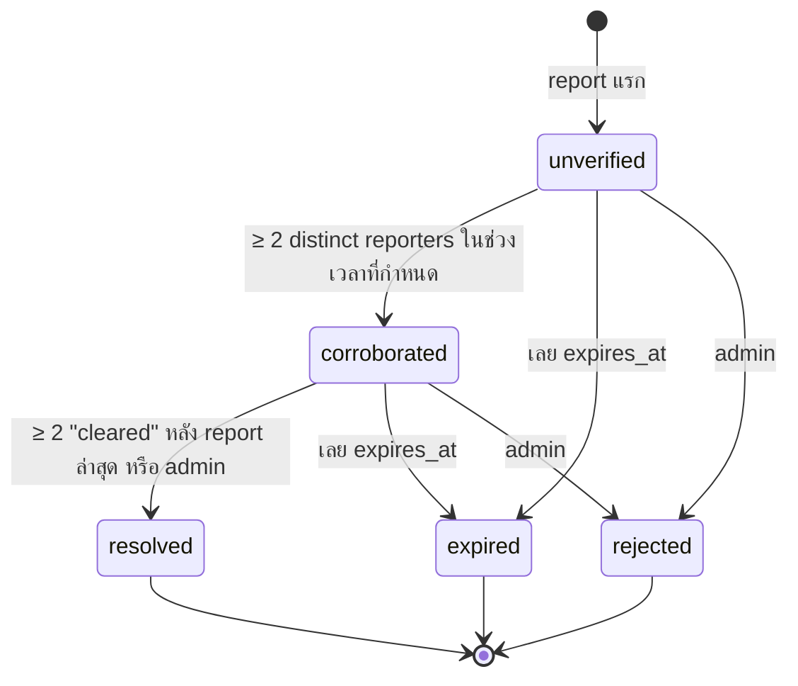

# DATABASE_DESIGN.md — RiderOS AI (Phase 0)

> **อัปเดต 2026-11-18:** เอา Pickup Intelligence ออกจากแอปแล้ว (`docs/HANDOFF.md` §4.20). Migration `0006` ลบตาราง `restaurants`, `restaurant_time_stats`, `pickup_logs`, `pickup_predictions` และแถว `pickup_o2p` ใน `model_versions`. ตาราง `model_versions` ยังอยู่ (RoadContext ใช้) ส่วนที่พูดถึงตาราง Pickup ด้านล่างคือแบบเดิม เก็บไว้เป็นบันทึก

> สถานะ: อนุมัติแล้ว (Phase 0, 2026-11-05)
> DBMS: PostgreSQL + PostGIS (Pin เวอร์ชันใน Phase 2) · Migration: Alembic เท่านั้น

---

## 1. หลักการออกแบบ

1. **Primary Key** ทุกตารางเป็น `uuid` ใช้ `DEFAULT gen_random_uuid()` เพื่อป้องกันการเดา ID แบบเรียงลำดับ
2. **User isolation:** ทุกตารางที่เป็นข้อมูลส่วนตัวมี `user_id uuid NOT NULL REFERENCES users(id)` + Index; Repository Layer Filter ด้วย `user_id` ทุก Query; อ่านหรือแก้ข้อมูลของ User อื่นจะได้ **404**
3. **เงิน:** `numeric(12,2)` + `CHECK (amount >= 0)`; สกุลเงิน THB (เก็บไว้ใน `rider_profiles.currency` เผื่อขยายในอนาคต)
4. **เวลา:** `timestamptz` (UTC) สำหรับเหตุการณ์; `date` สำหรับรายการที่ผูกกับวัน; Timezone ของผู้ใช้อยู่ใน `rider_profiles.timezone`
5. **Enum:** ใช้ `text` + `CHECK (... IN (...))` แทน Postgres ENUM เพราะเพิ่มค่าผ่าน Migration ได้ง่ายกว่า
6. **Timestamps:** `created_at timestamptz NOT NULL DEFAULT now()` และ `updated_at` (ตารางที่แก้ไขได้; อัปเดตใน ORM `onupdate`)
7. **พิกัด:** `geography(Point, 4326)` + GiST Index ระยะทางคิดเป็นเมตร (`ST_DWithin`)
8. **Demo data:** ตารางที่อาจมี Demo มี `is_demo boolean NOT NULL DEFAULT false` และ Demo อยู่ใน Demo Account เท่านั้น

---

## 2. ER Diagram

```mermaid
erDiagram
    users ||--o| rider_profiles : "1:1"
    users ||--o{ refresh_tokens : has
    users ||--o{ password_reset_tokens : has
    users ||--o{ work_sessions : logs
    users ||--o{ income_records : owns
    users ||--o{ expense_records : owns
    work_sessions |o--o{ income_records : "optional"
    work_sessions |o--o{ expense_records : "optional"
    users ||--o{ shift_scenarios : plans
    work_sessions |o--o{ shift_scenarios : "actual result"
    users |o--o{ restaurants : "owns (source=user)"
    restaurants ||--o{ restaurant_time_stats : "aggregates"
    users ||--o{ pickup_logs : records
    restaurants ||--o{ pickup_logs : at
    users ||--o{ pickup_predictions : requests
    restaurants |o--o{ pickup_predictions : for
    model_versions ||--o{ pickup_predictions : produced_by
    model_versions |o--o{ shift_scenarios : "ml estimate"
    road_incidents ||--o{ incident_reports : groups
    users ||--o{ incident_reports : submits
    model_versions |o--o{ incident_reports : "ai label"

    users {
        uuid id PK
        text email "unique lower(email)"
        text password_hash "argon2id"
        text display_name
        text role "rider|admin"
        boolean is_active
        timestamptz created_at
        timestamptz updated_at
    }
    rider_profiles {
        uuid user_id PK, FK
        text vehicle_type
        numeric fuel_km_per_liter
        numeric fuel_price_per_liter
        numeric depreciation_per_km
        numeric daily_goal
        text timezone
        text currency
    }
    refresh_tokens {
        uuid id PK
        uuid user_id FK
        uuid family_id
        text token_hash "sha256, unique"
        timestamptz expires_at
        timestamptz revoked_at
    }
    password_reset_tokens {
        uuid id PK
        uuid user_id FK
        text token_hash
        timestamptz expires_at
        timestamptz used_at
    }
    work_sessions {
        uuid id PK
        uuid user_id FK
        timestamptz started_at
        timestamptz ended_at
        numeric distance_km
        int order_count
        boolean is_demo
    }
    income_records {
        uuid id PK
        uuid user_id FK
        uuid work_session_id FK "nullable"
        date occurred_on
        numeric amount
        int order_count
        numeric distance_km
        numeric working_hours "nullable"
        text source_label "free text"
        boolean is_demo
    }
    expense_records {
        uuid id PK
        uuid user_id FK
        uuid work_session_id FK "nullable"
        date occurred_on
        text category "fuel|maintenance|depreciation|other"
        numeric amount
        text description
        boolean is_demo
    }
    shift_scenarios {
        uuid id PK
        uuid user_id FK
        text name
        time start_time
        time end_time
        int duration_minutes
        smallint planned_weekday "nullable"
        jsonb assumptions
        text estimation_method "assumption|historical|ml"
        numeric estimated_revenue
        numeric estimated_expenses
        numeric estimated_net_profit
        numeric estimate_low
        numeric estimate_high
        uuid model_version_id FK "nullable"
        uuid actual_work_session_id FK "nullable"
    }
    restaurants {
        uuid id PK
        text source "dataset_meituan|dataset_skip|user"
        text external_ref "poi_id"
        uuid owner_user_id FK "null for dataset"
        text name
        geography location "nullable"
    }
    restaurant_time_stats {
        uuid restaurant_id PK, FK
        text day_type PK "weekday|weekend"
        smallint hour PK
        int n_orders
        numeric median_min
        numeric p25_min
        numeric p75_min
        numeric p90_min
        text dataset_version
    }
    pickup_logs {
        uuid id PK
        uuid user_id FK
        uuid restaurant_id FK
        timestamptz arrived_at
        timestamptz picked_up_at
        text notes
    }
    model_versions {
        uuid id PK
        text name
        text version
        text task
        text dataset
        jsonb metrics
        jsonb feature_schema
        text artifact_uri
        boolean is_active
        timestamptz trained_at
    }
    pickup_predictions {
        uuid id PK
        uuid user_id FK
        uuid restaurant_id FK "nullable"
        uuid model_version_id FK
        jsonb input_features
        numeric predicted_minutes
        numeric interval_low
        numeric interval_high
        text data_availability
        timestamptz created_at
    }
    road_incidents {
        uuid id PK
        text category
        text status
        geography location
        timestamptz first_reported_at
        timestamptz last_reported_at
        int report_count
        int distinct_reporters
        timestamptz expires_at
    }
    incident_reports {
        uuid id PK
        uuid incident_id FK
        uuid user_id FK
        text report_type "report|still_present|cleared"
        text category
        text description
        geography location
        text image_key "nullable"
        text ai_status "none|pending|done|failed"
        text ai_label
        numeric ai_confidence
        uuid ai_model_version_id FK
        timestamptz created_at
    }
```



---

## 3. รายละเอียดตาราง

### 3.1 `users`
| Column | Type | Constraint |
|---|---|---|
| id | uuid | PK |
| email | text | NOT NULL; `UNIQUE INDEX ON lower(email)` |
| password_hash | text | NOT NULL |
| display_name | text | NOT NULL, length 1–80 |
| role | text | NOT NULL DEFAULT 'rider', CHECK IN ('rider','admin') |
| is_active | boolean | NOT NULL DEFAULT true |
| created_at / updated_at | timestamptz | NOT NULL |

### 3.2 `rider_profiles` (1:1 กับ users)
| Column | Type | Constraint |
|---|---|---|
| user_id | uuid | PK, FK → users ON DELETE CASCADE |
| vehicle_type | text | CHECK IN ('motorcycle','ev_motorcycle','bicycle','car','other') |
| fuel_km_per_liter | numeric(6,2) | NULL หรือ > 0 |
| fuel_price_per_liter | numeric(8,2) | NULL หรือ ≥ 0 |
| depreciation_per_km | numeric(8,4) | NULL หรือ ≥ 0 (ใช้ประมาณต้นทุนใน Simulator) |
| daily_goal | numeric(12,2) | NULL หรือ > 0 · เป้ากำไรสุทธิต่อวัน (วงแหวนบน Home) · Migration 0005 |
| timezone | text | NOT NULL DEFAULT 'Asia/Bangkok' (ตรวจกับ IANA ใน Service) |
| currency | text | NOT NULL DEFAULT 'THB' |

### 3.3 `refresh_tokens` / `password_reset_tokens`
- เก็บเฉพาะ `token_hash` (SHA-256) ไม่เก็บ Token จริง
- `refresh_tokens.family_id` ใช้ Revoke ทั้งสาย Token เมื่อพบการใช้ Token ซ้ำ (Reuse Detection)
- Index: `UNIQUE(token_hash)`, `(user_id)`, `(expires_at)` สำหรับงาน Cleanup
- Password reset: อายุ 30 นาที ใช้ได้ครั้งเดียว (`used_at`)

### 3.4 `work_sessions`
| Column | Type | Constraint |
|---|---|---|
| started_at, ended_at | timestamptz | NOT NULL; `CHECK (ended_at > started_at)`; `CHECK (ended_at - started_at <= interval '24 hours')` |
| distance_km | numeric(8,2) | NULL หรือ ≥ 0 |
| order_count | int | NULL หรือ ≥ 0 |
| notes | text | ≤ 500 ตัวอักษร |

Index: `(user_id, started_at DESC)`
Service ตรวจไม่ให้ Session ของผู้ใช้คนเดียวกันซ้อนทับกัน (ถ้าต้องการบังคับระดับ DB ใช้ `EXCLUDE USING gist (user_id WITH =, tstzrange(started_at, ended_at) WITH &&)` ซึ่งต้องใช้ btree_gist)

### 3.5 `income_records`
| Column | Type | Constraint |
|---|---|---|
| work_session_id | uuid | FK → work_sessions ON DELETE SET NULL |
| occurred_on | date | NOT NULL |
| amount | numeric(12,2) | NOT NULL, ≥ 0 |
| order_count | int | NULL หรือ ≥ 0 |
| distance_km | numeric(8,2) | NULL หรือ ≥ 0 |
| working_hours | numeric(5,2) | NULL หรือ 0 < x ≤ 24 |
| source_label | text | ≤ 50 ตัวอักษร (เช่น "Grab" ที่ผู้ใช้พิมพ์เอง — **ไม่ใช่ Integration**) |
| notes | text | ≤ 500 |

Index: `(user_id, occurred_on DESC)`, `(work_session_id)`

### 3.6 `expense_records`
| Column | Type | Constraint |
|---|---|---|
| category | text | CHECK IN ('fuel','maintenance','depreciation','other') |
| amount | numeric(12,2) | NOT NULL, ≥ 0 |
| occurred_on | date | NOT NULL |
| description | text | ≤ 500 |

Index: `(user_id, occurred_on DESC)`, `(user_id, category)`

### 3.7 กฎการคำนวณของ TrueProfit (ทำใน SQL/Service ไม่ใช้ AI)

```
Total Revenue      = SUM(income_records.amount)  ในช่วงวันที่ (ตาม timezone ผู้ใช้)
Total Expenses     = SUM(expense_records.amount) ในช่วงเดียวกัน
Net Profit         = Total Revenue − Total Expenses
Working Hours      = SUM(duration ของ work_sessions ที่ started_at อยู่ในช่วง)
                   + SUM(income_records.working_hours WHERE work_session_id IS NULL)
Revenue / Hour     = Total Revenue / Working Hours   → null ถ้า Working Hours = 0
Net Profit / Hour  = Net Profit / Working Hours      → null ถ้า Working Hours = 0
```

- เมื่อ Working Hours = 0 หรือไม่มีข้อมูล API จะคืน `null` + `reason: "no_working_hours"` **ห้ามคืน 0 หรือ Infinity**
- Session ที่ข้ามเที่ยงคืนนับเข้าวันที่เริ่ม (`started_at` ตาม timezone ผู้ใช้) — กฎนี้ต้องระบุใน UI และ Documentation
- Income ที่ผูกกับ Session แล้วจะไม่นับ `working_hours` ของตัวเองซ้ำ (ป้องกันการนับชั่วโมงสองครั้ง)

### 3.8 `shift_scenarios`
| Column | Type | Constraint |
|---|---|---|
| name | text | NOT NULL, 1–60 |
| start_time, end_time | time | NOT NULL (End < Start หมายถึงข้ามเที่ยงคืน) |
| duration_minutes | int | NOT NULL, CHECK 30–960 (Service คำนวณจาก Start/End) |
| planned_weekday | smallint | NULL หรือ 0–6 |
| assumptions | jsonb | Input ที่ใช้: `orders_per_hour`, `income_per_order`, `km_per_order`, `fuel_price_per_liter`, ... (Validate ด้วย Pydantic) |
| estimation_method | text | CHECK IN ('assumption','historical','ml') |
| estimated_revenue / estimated_expenses / estimated_net_profit | numeric(12,2) | NOT NULL |
| estimate_low / estimate_high | numeric(12,2) | NULL (มีเฉพาะเมื่อมีวิธีคำนวณช่วงรองรับ) |
| model_version_id | uuid | FK → model_versions, NULL ยกเว้นเมื่อ method = 'ml' |
| actual_work_session_id | uuid | FK → work_sessions ON DELETE SET NULL (ใช้เปรียบเทียบแผนกับผลจริง) |

Index: `(user_id, created_at DESC)`
ค่าที่ขึ้นต้นด้วย **estimated_*** ไม่ถูกนำไปรวมกับข้อมูล Actual ของ TrueProfit (แยก Actual กับ Estimated ตาม Requirement)

### 3.9 `restaurants` (ลบแล้ว 2026-11-18, Migration 0006)
| Column | Type | Constraint |
|---|---|---|
| source | text | CHECK IN ('dataset_meituan','dataset_skip','user') |
| external_ref | text | รหัสใน Dataset (เช่น poi_id) |
| owner_user_id | uuid | FK → users ON DELETE CASCADE |
| name | text | Dataset: "POI-{poi_id}" (ไม่มีชื่อจริง), User: ชื่อที่ผู้ใช้ตั้ง |
| location | geography(Point,4326) | NULL ได้ (พิกัดของ Dataset ถูกเลื่อน จึง **ไม่นำมาแสดงบนแผนที่จริง**) |

Constraints:
- `UNIQUE (source, external_ref)` WHERE external_ref IS NOT NULL
- `CHECK ((source = 'user') = (owner_user_id IS NOT NULL))`

การเข้าถึง: Dataset restaurants ทุกคนอ่านได้; User restaurants อ่านได้เฉพาะเจ้าของ
Index: `(owner_user_id)`, GiST `(location)`, trigram `(name)` สำหรับค้นหา (`pg_trgm`)

### 3.10 `restaurant_time_stats` (ลบแล้ว 2026-11-18, Migration 0006)
- สถิติรวม (Aggregate) ต่อร้าน × ประเภทวัน × ชั่วโมง ส่งออกจาก ML Pipeline แล้ว Import ด้วยสคริปต์ — **ไม่นำ Raw Dataset เข้า DB ของ Production**
- PK: `(restaurant_id, day_type, hour)`; `CHECK (hour BETWEEN 0 AND 23)`; `n_orders ≥ 0`
- ใช้กับ Restaurant Analytics (Distribution, Peak Hour, Comparison)
- ถ้า `n_orders` < เกณฑ์ UI ต้องแสดงคำเตือน

### 3.11 `pickup_logs` (Personal Pickup Log, ลบแล้ว 2026-11-18, Migration 0006)
| Column | Type | Constraint |
|---|---|---|
| arrived_at | timestamptz | NOT NULL (Rider มาถึงร้าน) |
| picked_up_at | timestamptz | NOT NULL; `CHECK (picked_up_at >= arrived_at)`; `CHECK (picked_up_at - arrived_at <= interval '3 hours')` |
| notes | text | ≤ 300 |

Index: `(user_id, restaurant_id, arrived_at DESC)`
Rider Wait = `picked_up_at − arrived_at` — **เป็นข้อมูลเวลารอจริงเพียงแหล่งเดียวในระบบ**
Wait-stats แสดงเมื่อ n ≥ 5 (Label "Low confidence" จนกว่า n ≥ 20) ใช้ Median และ P80

### 3.12 `model_versions`
- `UNIQUE (name, version)`; `is_active` ต่อ `name` มีได้แค่ 1 (Partial Unique Index `WHERE is_active`)
- `metrics` = ผลการประเมินบน Test Set จริงจาก `metrics.json` (ห้ามกรอกด้วยมือ)

### 3.13 `pickup_predictions` (เป็น Prediction History ด้วย, ลบแล้ว 2026-11-18, Migration 0006)
- Prompt ระบุทั้ง `pickup_predictions` และ `prediction_history` แต่ทั้งสองเก็บข้อมูลเดียวกัน (Input, Output, เวลา, Model Version) จึง **รวมเป็นตารางเดียว** เพื่อไม่ให้ข้อมูลซ้ำซ้อน Endpoint History จะ Query จากตารางนี้
- `data_availability` CHECK IN ('sufficient','limited','insufficient')
- Index: `(user_id, created_at DESC)`, `(model_version_id)`

### 3.14 `road_incidents`
| Column | Type | Constraint |
|---|---|---|
| category | text | CHECK IN ('flooding','road_damage','road_closure','road_obstacle','traffic_incident') |
| status | text | CHECK IN ('unverified','corroborated','resolved','expired','rejected') |
| location | geography(Point,4326) | NOT NULL |
| report_count, distinct_reporters | int | ≥ 0 |
| expires_at | timestamptz | NOT NULL (คำนวณจาก TTL ของหมวดหมู่) |

Index: GiST `(location)`, `(status, expires_at)`, `(category, last_reported_at DESC)`

### 3.15 `incident_reports`
- `user_id` FK → users ON DELETE CASCADE (ลบบัญชีจะลบ Report และรูปของผู้ใช้; Service คำนวณ `report_count` ใหม่ใน Transaction เดียวกัน)
- `UNIQUE (incident_id, user_id) WHERE report_type = 'report'` ทำให้ผู้ใช้หนึ่งคนนับเป็น 1 Report ต่อ Incident
- `ai_confidence` CHECK 0–1; `ai_*` เป็น "คำแนะนำ" เท่านั้น
- Index: `(incident_id, created_at)`, `(user_id, created_at DESC)`
- **Phase 5 (P5a, Migration `0004`):** เพิ่ม `UNIQUE (incident_id, user_id) WHERE report_type IN ('still_present','cleared')` — ยืนยันใหม่แทนที่ของเดิม (1 คำตอบต่อคนต่อเหตุ) · `location` มีเฉพาะ `report_type = 'report'` · การยืนยันไม่มีรูป/คำอธิบาย · `road_incidents` เพิ่ม `status_changed_at`, `created_at`, `updated_at` · `distinct_reporters` = ผู้ใช้ที่ report หรือ still_present

---

## 4. Incident Status Machine (Rule-based เริ่มต้น — ปรับค่าใน Phase 5)



| หมวด | รัศมีตรวจซ้ำ | ช่วงเวลาตรวจซ้ำ | TTL หลัง report ล่าสุด |
|---|---|---|---|
| flooding | 300 m | 6 ชม. | 12 ชม. |
| road_damage | 50 m | 30 วัน | 90 วัน |
| road_closure | 200 m | 12 ชม. | 24 ชม. |
| road_obstacle | 100 m | 3 ชม. | 6 ชม. |
| traffic_incident | 200 m | 2 ชม. | 3 ชม. |

**Phase 5 (P5a):** `unverified` → `resolved` ก็ได้ (≥ 2 cleared หลัง report ล่าสุด) เพื่อไม่ให้ Report ผิดค้างจนหมด TTL · Admin ตั้งได้เฉพาะ `resolved`/`rejected` · `expired` คิดตอนอ่าน แล้วเขียนลงแถวเมื่อมีการเขียนครั้งถัดไป (ไม่มี Scheduler) · Corroborate นับผู้ใช้ที่ report/still_present ภายในช่วงเวลาตรวจซ้ำนับจากตอนนี้

ค่าเหล่านี้เป็น **ค่าเริ่มต้นที่ยังไม่ได้ Validate** ต้องเก็บไว้ใน Config ไม่ Hardcode และ UI ต้องแสดง "รายงานโดยผู้ใช้ · อัปเดตล่าสุด X นาทีที่แล้ว" **ห้ามใช้คำว่า Real-time**

---

## 5. Data Isolation — Checklist

| ตาราง | เจ้าของ | การเข้าถึง |
|---|---|---|
| rider_profiles, work_sessions, income_records, expense_records, shift_scenarios, pickup_logs, pickup_predictions | `user_id` | เจ้าของเท่านั้น |
| restaurants (source=user) | `owner_user_id` | เจ้าของเท่านั้น |
| restaurants (dataset), restaurant_time_stats, model_versions | — | ทุกคนที่ Login อ่านได้, เขียนได้เฉพาะสคริปต์หรือ Admin |
| road_incidents | ส่วนกลาง | ทุกคนที่ Login อ่านได้ (ไม่เปิดเผยผู้รายงาน) |
| incident_reports | `user_id` | ผู้ใช้เห็น Report ของตัวเอง; Public API แสดงเฉพาะข้อมูลรวม |

**Tests ที่ต้องมี (Phase 2):** สร้างผู้ใช้ A และ B แล้วให้ B เรียก GET/PATCH/DELETE ทรัพยากรของ A ทุก Endpoint ผลที่คาดหวังคือ 404 และข้อมูลไม่เปลี่ยน
**Hardening (Phase 6, ทางเลือก):** Postgres Row-Level Security ใช้คู่กับ `SET app.user_id`

---

## 6. Extensions & Ops

- Extensions: `postgis`, `pg_trgm`, `btree_gist` (ถ้าใช้ Exclusion Constraint)
- DB Role ของแอปไม่ใช่ Superuser และไม่มีสิทธิ์ DDL ใน Production (Migration ใช้ Role แยก)
- Backup (Phase 7): `pg_dump` รายวัน + Retention 7 วัน (หรือใช้ Managed Backup ของผู้ให้บริการ) และ **ทดสอบ Restore** อย่างน้อย 1 ครั้งก่อน Demo
