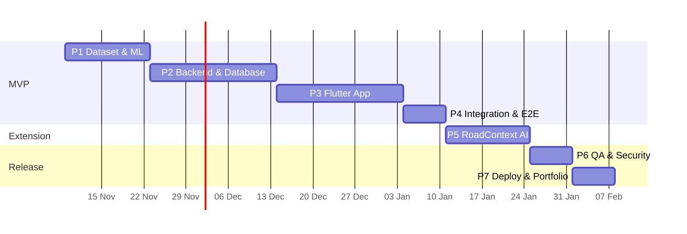

# DEVELOPMENT_ROADMAP.md — RiderOS AI (Phase 0)

> **อัปเดต 2026-11-19:** RoadContext (Phase 5) และ `ml/` (Phase 1) ถูกเอาออกจาก Repo แล้ว (`docs/HANDOFF.md` §4.21) เอกสารนี้คือแผนเดิม
>
> **อัปเดต 2026-11-18:** Pickup Intelligence ถูกเอาออกจากแอปแล้ว (`docs/HANDOFF.md` §4.20) เอกสารนี้คือแผนเดิม เก็บไว้เป็นบันทึก

> สถานะ: อนุมัติแล้ว (Phase 0, 2026-11-05) · Phase 1 เริ่ม 2026-11-05 · **Phase 1 อนุมัติแล้ว 2026-11-09** · **Phase 4 อนุมัติแล้ว 2026-11-12 (MVP Freeze)** · **Phase 6 อนุมัติแล้ว 2026-11-14**
> ระยะเวลา: 13 สัปดาห์ (≈ 3 เดือน) เริ่ม **จันทร์ 2026-11-09** ถ้าอนุมัติ Phase 0 ภายในสัปดาห์นี้
> MVP (Module 1–3) เสร็จสิ้นปลายสัปดาห์ที่ 9 · RoadContext เป็น Extension
> ทุก Phase จบด้วย **Phase Report** และ **รอการอนุมัติ** ก่อนเริ่ม Phase ถัดไป

---

## 1. Timeline



| สัปดาห์ | วันที่ | Phase | งานหลัก |
|---|---|---|---|
| W1 | 09–15 พ.ย. | P1a | Git init + `.gitignore`, ตั้ง env (uv, Python 3.14), สคริปต์ดาวน์โหลด + Checksum, Data Validation, EDA Notebook, Leakage Review, Temporal Split |
| W2 | 16–22 พ.ย. | P1b | Baselines → LR/RF/XGBoost/CatBoost, Tuning บน Validation, ประเมินบน Test ครั้งเดียว, Conformal Interval, Export Artifact + Model Card, Restaurant Stats Export |
| W3 | 23–29 พ.ย. | P2a | Docker Compose (PostGIS), FastAPI Skeleton, Config/Logging/Errors, Alembic Migration ชุดแรก, Auth (Register/Login/Refresh/Logout) + Tests |
| W4 | 30 พ.ย.–6 ธ.ค. | P2b | TrueProfit CRUD + Summaries/Trends (Timezone-aware) + Tests; Rider Profile |
| W5 | 7–13 ธ.ค. | P2c | Pickup API (Model Registry, Predictions, Analytics, Pickup Log), Shift Simulator API, Rate Limiting, Cross-user Tests |
| W6 | 14–20 ธ.ค. | P3a | `flutter create`, Design System (tokens, Light/Dark), go_router + Auth Guard, dio Client + Token Refresh, Splash/Onboarding/Login/Register/Forgot |
| W7 | 21–27 ธ.ค. | P3b | Home Dashboard, TrueProfit Dashboard, Income/Expense Management (Forms + Validation + States) — *สัปดาห์วันหยุด ใช้เป็น Buffer ได้* |
| W8 | 28 ธ.ค.–3 ม.ค. | P3c | Pickup Intelligence + Restaurant Details, Shift Simulator + Scenario Comparison, Profile/Settings |
| W9 | 4–10 ม.ค. | P4 | Integration กับ Backend จริง, E2E Journey, แก้ Bug → **MVP Freeze** |
| W10 | 11–17 ม.ค. | P5a | RoadContext: Report + Map + Nearby + Dedup/Status Rules (ยังไม่มี CV) |
| W11 | 18–24 ม.ค. | P5b | ตรวจ License ของ CV Dataset, Transfer Learning Classifier, CV Service, Async Labeling |
| W12 | 25–31 ม.ค. | P6 | Security Audit, Performance (p95 latency), Regression Suite, Docs |
| W13 | 1–7 ก.พ. | P7 | Deploy Backend + DB, Release APK, README + Screenshots, Resume Materials, Demo |

---

## 2. Phase Details & Exit Criteria

### Phase 1 — Dataset Engineering & ML (W1–W2)
**Deliverables**
- `ml/` package + `ml/data/SOURCES.md`
- EDA Notebook
- Validation Report
- `ml/reports/<version>/` (ตารางเปรียบเทียบโมเดล, Actual vs Predicted, Residual Plot, Error Distribution)
- `ml/artifacts/pickup/<version>/` (model, preprocessor, feature_schema.json, metrics.json, model_card.md)

**Exit criteria** (ตรวจ 2026-11-09)
- [x] รัน `train → evaluate` ใหม่ได้ผลตรงกัน (seed=42, Tolerance abs 1e-6) — `test_quick_pipeline_matches_stored_smoke_run` รัน `train --quick` ใหม่จาก `orders.parquet` แล้วตรงกับรอบ 2026-11-05; `test_reloaded_artifact_reproduces_reported_test_metrics` โหลด Artifact 1.0.0 แล้วได้ Test Metrics ตรงกับ `metrics.json`; `build_orders` deterministic (ทดสอบบนข้อมูลสังเคราะห์) · *ยังไม่ได้รัน Full train ซ้ำรอบที่สอง (~29 นาที)*
- [x] มี Leakage Review แยกทุก Feature (รู้ได้ ณ t₀ หรือไม่) — `ml/reports/pickup_o2p/1.0.0/RESULTS.md`
- [x] Test Set ถูกใช้ประเมินครั้งเดียว และบันทึกไว้ — `selection_decided_at` / `test_evaluated_at` ใน `metrics.json`
- [x] มีตาราง Baseline vs Models (MAE/RMSE/R²) จากการรันจริง — `RESULTS.md` (รวม Ablation + Meituan Benchmark)
- [x] Pytest: Feature Schema, Model Loading, Invalid Input, Edge Cases — 134 passed (`ml/tests/`)

**หมายเหตุ:** EDA ทำเป็นรายงานที่สร้างจาก CLI (`rideros-ml eda` → `ml/reports/eda/EDA_REPORT.md`) แทน Notebook เพื่อให้รันซ้ำได้; Artifact อยู่ที่ `ml/artifacts/pickup_o2p/1.0.0/` (ชื่อโมเดล `pickup_o2p`)

### Phase 2 — Backend & Database (W3–W5)
**Deliverables:** Migrations, API ตาม SYSTEM_ARCHITECTURE §4 (ยกเว้น RoadContext), OpenAPI, Tests

**Exit criteria** (ตรวจ 2026-11-09)
- [x] `docker compose up` แล้วได้ DB + API ใช้งานได้ภายในคำสั่งเดียว — `docker compose up --build`: Migration `0001 → 0003` + Import ร้าน (4,938 ร้าน / 73,340 cells) + โหลดโมเดล `pickup_o2p` 1.0.0 (ตรวจ SHA-256) → `/ready` ok; Smoke test register → prediction → analytics → shift scenario → DELETE /me ผ่าน
- [x] Coverage ของ `app/modules/**` ≥ 80% — **99%** (317 tests passed; ต่ำสุด auth 95%)
- [x] Cross-user Tests ผ่านทุก Endpoint — `backend/tests/api/test_cross_user.py` (TrueProfit, Profile, Pickup restaurants/logs/predictions/wait-stats, Shift scenarios/compare/estimate, DELETE /me ลบข้อมูลครบ)
- [x] Auth Tests: Token หมดอายุ, Token ปลอม, Refresh Reuse, Logout — `backend/tests/api/test_tokens.py` (expired/forged access, refresh reuse → revoke family, expired refresh, logout) + `test_auth.py`, `test_password_reset.py`, Rate limit ใน `test_rate_limits.py`
- [x] ไม่มี Secret ใน Repository (gitleaks ผ่าน) — gitleaks v8.30.0 `dir` (168 ไฟล์ที่ Commit ได้) + `git` (History) → no leaks found

**หมายเหตุ:** OpenAPI สร้างอัตโนมัติที่ `/docs` และ `/openapi.json` (ปิดเมื่อ `ENV=production`) · Contract สรุปใน `backend/README.md` · การตัดสินใจ P2a/P2b/P2c ใน `docs/HANDOFF.md` §3.1–3.3

### Phase 3 — Flutter App (W6–W8)
**Exit criteria**
- [ ] ทุกหน้าใน Scope มีครบทั้ง Loading / Empty / Error / Success State
- [ ] ทุก Form มี Validation + Widget Test
- [ ] Navigation Tests + Notifier/State Unit Tests
- [ ] ไม่มีปุ่มที่ไม่ทำงาน (ถ้า Feature ยังไม่พร้อม **ต้องซ่อน** ห้ามแสดงปุ่มที่ไม่มี Logic)
- [ ] `flutter analyze` ไม่มี Warning

### Phase 4 — Integration (W9)
**Exit criteria** (ตรวจ 2026-11-12 · **อนุมัติแล้ว 2026-11-12**, `cc2a8b9`, Tag `mvp-freeze`)
- [x] E2E: Register → Login → Dashboard → Pickup Prediction → Add Income → Add Expense → View Profit → Create Scenario → Compare (`integration_test` บน Emulator + API จริง) — `mobile/integration_test/app_journey_test.dart` บน `emulator-5554` + `docker compose` stack; สมัครแล้วแอป Login ให้เอง จึงมี Logout → Login คั่น (Register → Onboarding → Logout → Login → …) · All tests passed หลายรอบติดกัน
- [x] ตัวเลขใน App ตรงกับ DB (ตรวจด้วย SQL) — `mobile/test_driver/integration_test.dart` เทียบ 21 ค่ากับ `psql` (โปรไฟล์, ช่วง Pickup + ค่ากลาง, รายได้/ค่าใช้จ่าย/กำไร/ชั่วโมง/กำไรต่อชม. วันนี้ทั้ง Home และ TrueProfit, ค่าของ Scenario ทั้ง 2 ใน Compare, กำไรสูงสุด) → 21/21 ตรง แล้วลบบัญชีทดสอบผ่าน `DELETE /me` ไม่มีแถวเหลือ

### Phase 5 — RoadContext AI (W10–W11)
**Exit criteria** (ตรวจ 2026-11-12 · **อนุมัติแล้ว 2026-11-12**)
- [x] Report/Map/Nearby/Dedup ทำงานได้ และมี Test ของกฎ Dedup ทุกหมวด — P5a `04bd24c` (`backend/tests/api/test_road.py` parametrize ทั้ง 5 หมวดจาก `CATEGORIES`) + P5b `0ad4950`/`a113abf` ตรวจบน Emulator
- [x] CV: License ของ Dataset ยืนยันแล้ว, มี Metrics จริง (Accuracy/Precision/Recall/F1/Confusion Matrix หรือ mAP ถ้าทำ Detection) + Inference Latency — `cv_service/data/SOURCES.md` (RDD2022 + AlleyFloodNet CC BY 4.0, Flood10k CC BY-NC 4.0, SHA-256 pin) · Test n = 1,380: Accuracy 0.8804, Macro-F1 0.8755 (Baseline 0.2717), Precision/Recall/F1 รายคลาส + Confusion Matrix ใน `cv_service/reports/1.0.0/` · Latency CPU 1 thread ใน Container `cv` median 16.5 ms / p95 22.8 ms (60 ภาพ)
- [x] UI ไม่แสดงผล AI เป็น "ยืนยันแล้ว" — "AI แนะนำ: <หมวด> (xx%)" + `ค่าประมาณ` · Tests ใน `mobile/test/unit/features/road_test.dart` + `mobile/test/widget/road_screens_test.dart` · ตรวจบน Emulator 2026-11-12

### Phase 6 — QA (W12)
**Exit criteria** (การตัดสินใจ HANDOFF §4.13 ข้อ 10 · ตรวจ 2026-11-14 · **อนุมัติแล้ว 2026-11-14**)
- [x] Security checklist (SYSTEM_ARCHITECTURE §5) ผ่านทุกข้อหรือเป็น Accepted risk — 11/11 ผ่าน · `docs/SECURITY_AUDIT.md`
- [x] ไม่มี High/Critical ค้าง — Dependency 0 · Docker image Critical 0, High ที่มีแพตช์ 0 · High 47 ที่ Debian ยังไม่มีแพตช์ = Accepted risk R-6
- [x] p95 วัดจริงผ่านเป้า — 24 Endpoint × c=1/c=10 × 200 req, Error 0 · `docs/PERFORMANCE.md`
- [x] Regression script เขียว — `scripts/regression.ps1` 14/14 ขั้น · `docs/TESTING.md`
- [x] Docs อัปเดต — `SECURITY_AUDIT.md`, `PERFORMANCE.md`, `TESTING.md` ใหม่ · SYSTEM_ARCHITECTURE §5 + โครงสร้าง Repo

### Phase 7 — Deploy & Portfolio (W13)
- ~~Security checklist (SYSTEM_ARCHITECTURE §5) ตรวจครบทุกข้อ~~ → ทำแล้วใน Phase 6 (ตรวจซ้ำบน Server จริง: `X-Forwarded-For`, Rate limiter หลาย Worker)
- APK Release (signing key **ไม่อยู่ใน Repo**)
- Backend ใช้งานบน URL จริง + Restore Test
- README ครบ 17 หัวข้อ
- Resume Bullets ใช้เฉพาะตัวเลขที่วัดได้จริง

---

## 3. Feature Priority & Risk

| Feature | Priority | Risk | เหตุผลของความเสี่ยง | แผนรับมือ |
|---|---|---|---|---|
| Auth + User Isolation | P0 | ต่ำ | Pattern มาตรฐาน | Tests ครอบคลุม |
| TrueProfit (CRUD + Summaries) | P0 | ต่ำ | สูตรตรงไปตรงมา; จุดเสี่ยงคือ Timezone/Hours | Unit Tests ของสูตร + กรณีขอบ |
| Pickup ML Model | P0 | **กลาง** | Dataset (D1), Leakage, Domain Shift | Protocol ใน DATASET_ANALYSIS §7; Baseline ก่อน |
| Restaurant Analytics | P1 | กลาง | ขึ้นกับ D1 | ถ้าเลือก A จะทำได้แค่ Pickup Log |
| Personal Pickup Log | P1 | ต่ำ | CRUD + Stats | — |
| Shift Simulator (Assumption/Historical) | P0 | ต่ำ–กลาง | ไม่มี Public Data | Scenario-based; ML เฉพาะเมื่อข้อมูลพอ |
| Shift Simulator (ML) | P3 | **สูง** | ไม่มีข้อมูลรายได้ Rider | เปิดใช้เมื่อผู้ใช้มี ≥ 60 Sessions; ใน MVP ยังไม่ทำ |
| K-Means Work Patterns | P2 | กลาง | ต้องมีข้อมูลผู้ใช้พอ + ตีความ Cluster ให้ได้ | ต้องมี ≥ 30 Sessions; ทดสอบด้วย Silhouette; ข้อมูลไม่พอจะซ่อน |
| Forgot Password | P1 | กลาง | ต้องมีบริการ Email | Dev: แสดง Link ใน Log (ระบุว่า Dev Only); Prod: SMTP Provider (D5) |
| RoadContext Map + Reports | P2 | กลาง | Tile Policy, PostGIS Queries | flutter_map + OSM (Dev) |
| CV Classifier | P3 | **สูง** | License ของ Dataset/Model, Domain Shift (ไม่มีภาพจากไทย) | ทำเป็นอันดับสุดท้าย; ตัดได้ถ้าเวลาไม่พอ |
| Object Detection (YOLO) | P4 | **สูง** | AGPL + Annotation | Optional |

**ลำดับการตัด Scope เมื่อเวลาไม่พอ:** (1) Object Detection → (2) CV Classifier → (3) K-Means → (4) RoadContext ทั้ง Module → **ห้ามตัด** Auth, TrueProfit, Pickup ML, Shift Simulator (Scenario), Tests

---

## 4. Phase Report Template (ใช้ทุก Phase)

```
## Phase N Report
- Completed Tasks
- Created Files
- Modified Files
- Architecture Decisions
- Testing Results (คำสั่งที่รัน + ผล)
- Remaining Tasks
- Known Issues
- Next Steps
```
