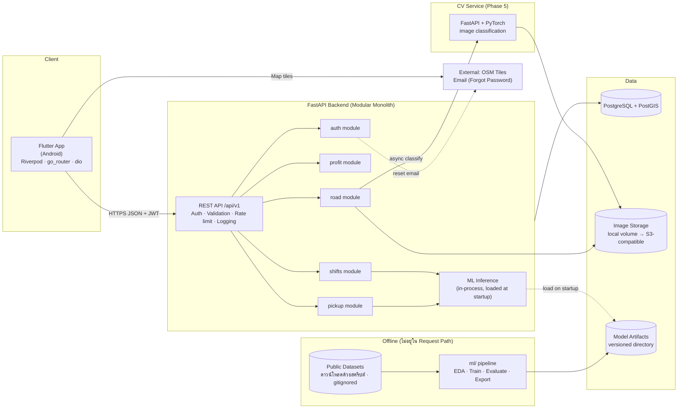
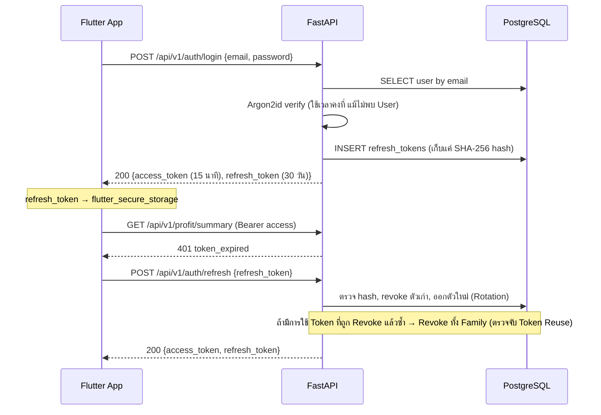
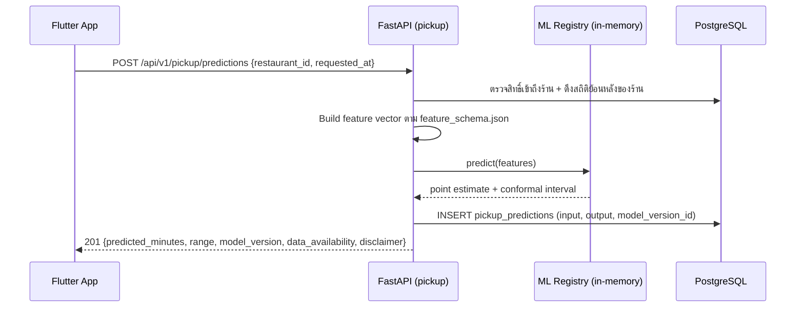
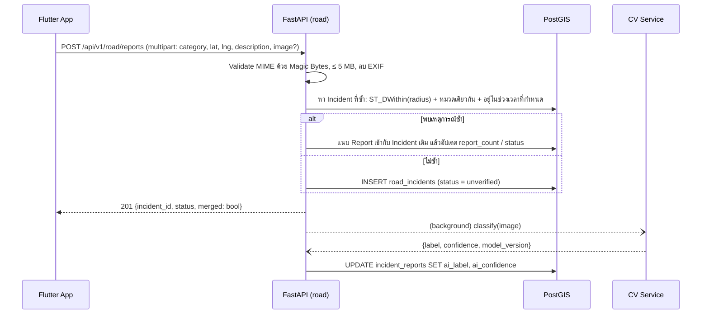

# SYSTEM_ARCHITECTURE.md — RiderOS AI (Phase 0)

> **อัปเดต 2026-11-18:** เอา Pickup Intelligence ออกจากแอปแล้ว (`docs/HANDOFF.md` §4.20): ไม่มี Module `pickup`, ไม่มี `/pickup/*` และ Backend ไม่โหลดโมเดลเอง (รูปถนนจัดประเภทใน `cv_service`). ส่วนที่พูดถึง Pickup ด้านล่างคือแบบเดิม เก็บไว้เป็นบันทึก `ml/` ยังอยู่เป็น Case study ที่แอปไม่ได้ใช้

> สถานะ: อนุมัติแล้ว (Phase 0, 2026-11-05) · ปรับปรุงตาม Decision D5/D6
> Diagram ทั้งหมดเขียนด้วย Mermaid (GitHub แสดงผลได้)

---

## 1. Architecture Overview

แนวทางคือ **Modular Monolith** สำหรับ Backend + **Offline ML Pipeline** แยกออกมา + **CV Service** แยกเป็นอีกบริการหนึ่ง (Phase 5)



### เหตุผลหลัก (Architecture Decisions)

| # | Decision | เหตุผล | ทางเลือกที่ไม่เลือก |
|---|---|---|---|
| AD-1 | Backend เป็น **Modular Monolith** แยก Module ตาม Domain | ทีม 1 คน ระยะ 3 เดือน; Deploy ง่าย; Module แยก Router/Service/Repository จึงแยกเป็น Service ภายหลังได้ | Microservices — มี Overhead มากเกินไปสำหรับ MVP |
| AD-2 | **ML Inference ทำงานใน Process เดียวกับ API** (Tabular Model โหลดครั้งเดียวตอน Startup ผ่าน FastAPI `lifespan`) | CatBoost/XGBoost มีขนาดเล็ก ใช้เวลาไม่กี่ ms; ไม่ Train ใหม่ทุก Request; ไม่มี Network Hop เพิ่ม | ML Service แยก — ปรับเป็นแบบนี้ได้ภายหลังโดยไม่เปลี่ยน Interface `PredictorProtocol` |
| AD-3 | **CV Service แยกบริการ** (Phase 5) | PyTorch มีขนาดใหญ่ (หลาย GB) ไม่ควรอยู่ใน Image ของ API; การจัดประเภทภาพทำแบบ Async จึงไม่ทำให้การสร้าง Report ช้าลง | ใส่ไว้ใน API — Image ใหญ่และ Cold Start ช้า |
| AD-4 | **ML Training เป็น Offline Pipeline** ใน `ml/` แยกจาก Backend | Reproducible; Artifact มี Version; Backend ขึ้นกับ Artifact ไม่ขึ้นกับโค้ด Train | Train ใน API — ห้ามตาม Requirement |
| AD-5 | **ใช้ Python เวอร์ชันเดียวกันทั้ง Train และ Serve** (3.14) | ป้องกันปัญหา Pickle/joblib ข้ามเวอร์ชัน | — |
| AD-6 | ข้อมูลเงินเป็น `NUMERIC(12,2)` ใน DB, `Decimal` ใน Python, **String ใน JSON**, ใช้ Package `decimal` ใน Dart | ไม่มี Floating-point Error ในการเงิน | float — มีปัญหาปัดเศษ |
| AD-7 | เวลาเก็บเป็น `timestamptz` (UTC); สรุปรายวันตาม `rider_profiles.timezone` (Default `Asia/Bangkok`) | ขอบเขตของ "วันนี้" ถูกต้องตามเวลาท้องถิ่น | เก็บ Local time — ผิดพลาดเมื่อข้าม Timezone |
| AD-8 | แผนที่ใช้ `flutter_map` + OpenStreetMap tiles (ตอนพัฒนา) | ไม่ต้องมี API Key หรือ Billing | Google Maps — ต้องใช้ Key + Billing; Production ต้องเปลี่ยน Tile Provider ตาม OSM Tile Policy |

---

## 2. Components

### 2.1 Flutter Mobile App
- **Architecture:** Feature-first + Clean Architecture แบบพอเหมาะ (`data/` → `domain/` → `presentation/`)
- **State:** Riverpod (Notifier/AsyncNotifier) — Business Logic อยู่ใน Notifier/UseCase ไม่อยู่ใน Widget
- **Navigation:** go_router + Auth Guard (Redirect ตามสถานะ Token)
- **Network:** dio + Interceptor ที่ใส่ Access Token และ Refresh อัตโนมัติเมื่อได้ 401 (มี Lock กัน Refresh ซ้ำ) และแปลง Error เป็น `AppFailure` แบบ Typed
- **Models:** freezed + json_serializable
- **Secure storage:** flutter_secure_storage เก็บ Refresh Token (Android Keystore)
- **Charts:** fl_chart · **Map:** flutter_map · **Location:** geolocator · **Image:** image_picker (บีบอัดก่อนอัปโหลด)
- **UI states:** ทุกหน้าที่ดึงข้อมูลต้องมี Loading / Empty / Error / Success ผ่าน `AsyncValue`

### 2.2 FastAPI Backend
- Python 3.14, FastAPI, Pydantic v2, SQLAlchemy 2.x (async) + asyncpg, Alembic, GeoAlchemy2
- **Layering ต่อ Module:** `router.py` (HTTP) → `service.py` (Business Logic) → `repository.py` (DB) + `schemas.py` (Pydantic) + `models.py` (ORM)
- **Cross-cutting:** `core/config.py` (pydantic-settings อ่านจาก ENV), `core/security.py` (Argon2id, JWT), `core/logging.py` (Structured JSON log + request_id), `core/rate_limit.py` (slowapi), `core/errors.py` (Error format เดียวกันทั้งระบบ)
- **ML integration:** `app/ml/registry.py` โหลด Artifact ตาม `MODEL_DIR` + `ACTIVE_MODEL_VERSION` แล้วตรวจ `feature_schema.json` ตอน Startup ถ้าไม่ตรงจะ Fail Fast

### 2.3 PostgreSQL + PostGIS
- Image `postgis/postgis` (Pin Tag ที่แน่นอนใน Phase 2) ผ่าน Docker Compose
- Migration ทั้งหมดผ่าน Alembic ห้ามแก้ Schema ด้วยมือ
- รายละเอียดอยู่ใน `DATABASE_DESIGN.md`

### 2.4 ML Pipeline (`ml/`)
- ขั้นตอน: `download → validate → build_dataset → split → train → tune → evaluate → export`
- Config เป็น YAML ต่อการทดลอง; Seed คงที่; บันทึก Data Hash + Git SHA ลงใน Metadata ของ Artifact
- Output ไปที่ `ml/artifacts/<model_name>/<version>/` (gitignored)
- Report (กราฟ + Metrics) ไปที่ `ml/reports/<version>/`

### 2.5 CV Service (Phase 5)
- FastAPI ขนาดเล็ก + PyTorch (torchvision) มี Endpoint เดียวคือ `POST /classify`
- Backend ส่งงานแบบ Background Task: สร้าง Report ก่อน (`ai_status = pending`) แล้วค่อยอัปเดตผลภายหลัง
- **AI ให้เพียง "หมวดหมู่ที่แนะนำ + Confidence"** ไม่เปลี่ยนสถานะเหตุการณ์เป็น Verified

---

## 3. Data Flows

### 3.1 Authentication (Login + Refresh)



### 3.2 Pickup Prediction



**หมายเหตุ:** ถ้าร้านมี Order ในข้อมูลไม่ถึงเกณฑ์ (เช่น < 30) Response จะคืน `data_availability = "insufficient"` และ UI ต้องแสดงคำเตือน

### 3.3 Incident Report (Phase 5)



---

## 4. API Design (v1)

**กฎร่วม**
- Base `/api/v1`; JSON; Error format เดียวกัน: `{"error": {"code": "...", "message": "...", "details": [...]}}`
- Status codes: 200/201/204, 400 (Validation ระดับ Domain), 401, 403, 404 (รวมกรณี Resource ของ User อื่น — เพื่อไม่ให้เดา ID ได้), 409, 413, 415, 422 (Pydantic), 429, 500
- Pagination: `?limit=&cursor=` (Cursor-based)
- OpenAPI/Swagger ที่ `/docs` (ปิดใน Production หรือป้องกันด้วย Auth)

| Module | Method & Path | หมายเหตุ |
|---|---|---|
| Health | `GET /health`, `GET /ready` | `/ready` ตรวจ DB และว่าโมเดลโหลดแล้ว |
| Auth | `POST /auth/register` | Rate-limited |
| | `POST /auth/login` | Rate-limited (ต่อ IP และต่อ Email) |
| | `POST /auth/refresh` | Rotation |
| | `POST /auth/logout` | Revoke Refresh Token |
| | `POST /auth/forgot-password`, `POST /auth/reset-password` | คืน 202 เสมอ (ไม่เปิดเผยว่ามี Email นี้หรือไม่) |
| Profile | `GET/PATCH /me`, `GET/PUT /me/rider-profile`, `DELETE /me` | `DELETE /me` = ลบบัญชี (PDPA) |
| TrueProfit | `GET/POST /income`, `GET/PATCH/DELETE /income/{id}` | |
| | `GET/POST /expenses`, `GET/PATCH/DELETE /expenses/{id}` | |
| | `GET/POST /work-sessions`, `GET/PATCH/DELETE /work-sessions/{id}` | |
| | `GET /profit/summary?period=day\|week\|month&date=YYYY-MM-DD` | Revenue, Expenses, Net, Hours, Rev/h, Net/h |
| | `GET /profit/trends?granularity=day\|week\|month&from=&to=` | Time series + Moving average (7 วัน/4 สัปดาห์/3 เดือน) + Linear trend (OLS, แสดงเส้นเฉพาะเมื่อ p < 0.05; ต้องมี ≥ 4 ช่วงที่มีรายการ ไม่งั้น `insufficient_data`) |
| | `GET /profit/patterns` | K-Means (เวลาเริ่ม, ความยาว, วันธรรมดา/สุดสัปดาห์ · 180 วัน); คืน `insufficient_data` ถ้า < 30 ช่วง และ `no_clear_pattern` ถ้าไม่ผ่าน Silhouette ≥ 0.25 + Permutation test + Bootstrap stability |
| | `GET /profit/heatmap` | กำไรสุทธิ/ชม. (ค่าประมาณ) ตามวันในสัปดาห์ × ช่วง 2 ชม. ตามเวลาท้องถิ่น · 90 วัน · เงินลงช่องผ่านช่วงทำงานเท่านั้น (รายการที่ผูก + รายการไม่ผูกของวันเดียวกันแบ่งตามความยาวช่วง, เฉลี่ยเท่ากันตลอดช่วง) · นับเฉพาะช่วงที่มีรายได้ · `insufficient_data` ถ้า < 10 ช่วง · ช่องที่ < 2 ช่วงหรือ < 1 ชม. ไม่มีค่าต่อชม. |
| Shift Simulator | `GET/POST /shift-scenarios`, `GET/PATCH/DELETE /shift-scenarios/{id}` | สร้างแล้วคำนวณ Estimate ทันที |
| | `POST /shift-scenarios/compare` `{ids: [...]}` | 2–5 Scenarios |
| | `POST /shift-scenarios/{id}/estimate` | คำนวณใหม่ด้วยข้อมูลล่าสุด |
| Pickup | `GET /pickup/restaurants?q=&source=` | Dataset POIs + ร้านที่ผู้ใช้สร้างเอง |
| | `POST /pickup/restaurants` | สร้างร้านส่วนตัว (ใช้กับ Pickup Log) |
| | `GET /pickup/restaurants/{id}/analytics` | Distribution, Peak Hours, n |
| | `POST /pickup/predictions`, `GET /pickup/predictions` | History |
| | `GET /pickup/model` | Version, Dataset, Metrics, Limitations |
| | `GET/POST /pickup/logs`, `DELETE /pickup/logs/{id}` | Personal Pickup Log |
| | `GET /pickup/restaurants/{id}/wait-stats` | Median/P80 ของ Rider Wait จริง (เมื่อมีข้อมูลพอ) |
| RoadContext | `POST /road/reports` | Multipart |
| | `GET /road/incidents?bbox=` | สำหรับแสดงบนแผนที่ |
| | `GET /road/incidents/nearby?lat=&lng=&radius_m=` | radius ≤ 5,000 m |
| | `GET /road/incidents/{id}` | |
| | `POST /road/incidents/{id}/confirmations` `{still_present: bool}` | ใช้ยืนยันหรือแจ้งว่าเหตุการณ์คลี่คลายแล้ว |
| | `PATCH /road/incidents/{id}/status` | **Admin เท่านั้น** |

---

## 5. Security Architecture (ตรวจแล้วใน Phase 6 — หลักฐานและความเสี่ยงที่ยอมรับ: `SECURITY_AUDIT.md`)

| ด้าน | การออกแบบ |
|---|---|
| Password | Argon2id (`pwdlib`/`argon2-cffi`), 8–128 ตัวอักษร + ตรวจกับรายการรหัสผ่านที่พบบ่อย (2,114 รายการ: SecLists 10k ที่ยาว ≥ 8 + รายการเดิม) + ห้ามซ้ำกับชื่อ E-mail |
| Tokens | Access JWT 15 นาที (HS256, Secret จาก ENV, ตรวจ `exp`/`iat`/`sub`/`type`); Refresh เป็น Opaque random 256-bit เก็บแค่ Hash, Rotation + Reuse Detection |
| Authorization | ทุก Query ของข้อมูลผู้ใช้ Filter ด้วย `user_id = current_user.id` ใน Repository Layer; Role `rider`/`admin`; มี Test Cross-user Access ทุก Endpoint |
| SQL Injection | ใช้ SQLAlchemy ORM/Bound Parameters เท่านั้น ห้ามต่อ String เป็น SQL |
| Validation | Pydantic `extra="forbid"` + Range/Length Constraints (ไม่ใช้ Strict mode: แปลงชนิดได้ เช่น `"500"` → Decimal); Validation ระดับ Domain ใน Service; Body ≤ 256 KiB (Multipart ≤ 5 MB + 64 KiB) ตรวจตอนรับข้อมูล |
| Rate limiting | `limits` (Moving window · `RATE_LIMIT_STORAGE_URL`: `memory://` ต่อ Process ใน Dev, Valkey `redis://` ใช้ร่วมทุก Worker ใน Production · Store ล่ม → 503 `rate_limit_unavailable` ไม่ปล่อยผ่าน): login 5/นาที ต่อ IP และต่อ E-mail, register 3/นาที/IP, forgot-password 3/นาที ต่อ IP และต่อ E-mail, reset 3/นาที/IP, รายงานเหตุ 10/นาที/User, ค่าทั่วไป 60/นาที/User · `X-Forwarded-For` เชื่อเฉพาะจาก Caddy (`FORWARDED_ALLOW_IPS=172.30.0.10`) · `docs/DEPLOYMENT.md` |
| CORS | Mobile App ไม่ต้องใช้ CORS; อนุญาตเฉพาะ Origin ที่กำหนดใน ENV (ค่าเริ่มต้นคือว่าง) |
| File upload | ตรวจ Magic Bytes (JPEG/PNG/WebP), ≤ 5 MB และ ≤ 40 MP, Re-encode ภาพ (ลบ EXIF รวมถึงพิกัด GPS), ตั้งชื่อไฟล์ใหม่เป็น UUID, ห้าม Serve จาก Path ที่ผู้ใช้ควบคุม |
| Secrets | `.env` (gitignored) + `.env.example`; Production ใช้ Secret ของ Platform; gitleaks ตรวจก่อน Commit (ใส่ใน CI ตอน Phase 7) |
| Privacy | Reporter ของ Incident ไม่ถูกเปิดเผยใน Public API; มี `DELETE /me`; Log ไม่บันทึก Token, Password หรือพิกัดละเอียด |
| Forgot Password (D5) | **Development เท่านั้น:** Reset Link แสดงใน Development Log; เก็บแค่ SHA-256 ของ Token; อายุ 30 นาที; ใช้ได้ครั้งเดียว (`used_at`); Token เดิมถูกยกเลิกเมื่อขอใหม่; ถ้า `ENV=production` และไม่มี Email Provider ระบบจะปิด Endpoint และ **ห้าม** Log Link (มี Test ยืนยัน) |

---

## 6. Project Folder Structure

```
RiderOS AI/
├── README.md
├── .gitignore                  # .env, ml/data/, ml/artifacts/, build outputs
├── .env.example                # ตัวอย่าง ENV (ไม่มีค่าจริง)
├── docker-compose.yml          # postgres+postgis, backend, (cv-service ใน Phase 5)
├── docs/
│   ├── PROJECT_PLAN.md
│   ├── SYSTEM_ARCHITECTURE.md
│   ├── DATABASE_DESIGN.md
│   ├── DATASET_ANALYSIS.md
│   ├── DEVELOPMENT_ROADMAP.md
│   ├── phase0/                 # สคริปต์ Profiling ของ Phase 0
│   └── adr/                    # Architecture Decision Records (เพิ่มเมื่อมีการตัดสินใจใหม่)
├── ml/
│   ├── pyproject.toml
│   ├── configs/                # pickup_catboost.yaml, ...
│   ├── data/                   # gitignored: raw/ interim/ processed/ + SOURCES.md (commit ได้)
│   ├── notebooks/              # EDA (ลบ Output ก่อน Commit)
│   ├── reports/                # กราฟและ Metrics ต่อ Version
│   ├── artifacts/              # gitignored
│   ├── src/rideros_ml/
│   │   ├── data/               # download.py, validate.py, build.py
│   │   ├── features/           # pickup_features.py (ใช้ร่วมกับ Backend ผ่าน schema)
│   │   ├── models/             # baselines.py, train.py, tune.py, evaluate.py
│   │   ├── intervals/          # conformal.py
│   │   └── export/             # export.py (artifact + schema + metrics + model card)
│   └── tests/
├── backend/
│   ├── pyproject.toml
│   ├── Dockerfile
│   ├── alembic.ini
│   ├── alembic/versions/
│   ├── app/
│   │   ├── main.py             # create_app(), lifespan (โหลดโมเดล)
│   │   ├── core/               # config, security, logging, rate_limit, errors
│   │   ├── db/                 # engine, session, base
│   │   ├── ml/                 # registry.py, predictor.py, feature_builder.py
│   │   └── modules/
│   │       ├── auth/           # router, schemas, service, repository, models
│   │       ├── users/
│   │       ├── profit/
│   │       ├── shifts/
│   │       ├── pickup/
│   │       └── road/
│   ├── scripts/                # seed_demo.py (Demo Account เท่านั้น), import_restaurant_stats.py
│   └── tests/
│       ├── unit/
│       ├── api/
│       └── conftest.py         # Test DB (PostGIS container)
├── cv_service/                 # Phase 5
│   ├── Dockerfile
│   ├── app/
│   └── tests/
├── mobile/                     # flutter create --project-name rideros_ai --org <org> mobile
│   ├── pubspec.yaml
│   ├── lib/
│   │   ├── main.dart
│   │   ├── app/                # app.dart, router.dart, theme/ (tokens, light, dark)
│   │   ├── core/               # network/ (dio, interceptors), storage/, errors/, utils/, widgets/ (design system)
│   │   └── features/
│   │       ├── auth/           # data/ domain/ presentation/
│   │       ├── onboarding/
│   │       ├── dashboard/
│   │       ├── pickup/
│   │       ├── profit/
│   │       ├── shifts/
│   │       ├── road/
│   │       └── profile/        # รวม Settings
│   └── test/                   # widget/, unit/ (E2E อยู่ที่ mobile/integration_test/ + test_driver/)
├── scripts/regression.ps1      # Regression ทุกชุดในเครื่อง + Coverage gate (Phase 6 · docs/TESTING.md)
└── .github/workflows/          # (Phase 7 ยังไม่มี) backend-ci.yml, ml-ci.yml, mobile-ci.yml
```

**หมายเหตุเรื่อง Path:** โฟลเดอร์โปรเจกต์มีเว้นวรรค (`RiderOS AI`) ทุกสคริปต์จึงต้อง Quote Path ส่วนชื่อ Flutter project และ Python package ใช้ `rideros_ai`/`rideros_ml` (ไม่มีเว้นวรรค)

---

## 7. Technology Stack (ยืนยันและปรับ)

| Layer | ตาม Prompt | ข้อเสนอเพิ่มเติมหรือปรับ | เหตุผล |
|---|---|---|---|
| Mobile | Flutter, Dart, M3, Riverpod | + go_router, dio, freezed, fl_chart, flutter_map, flutter_secure_storage | มาตรฐานของ Ecosystem; ไม่ขัดกับ Prompt |
| Backend | FastAPI, Pydantic, SQLAlchemy, Alembic | + asyncpg, GeoAlchemy2, pydantic-settings, slowapi, pwdlib[argon2], PyJWT, structlog | ครอบคลุม Requirement ด้าน Security และ Logging |
| DB | PostgreSQL + PostGIS | — | ตรงตาม Prompt |
| ML | pandas, numpy, scikit-learn, CatBoost, XGBoost, matplotlib, joblib | + Optuna (Tuning), Pandera (Data Validation) | Requirement ต้องการ Data Validation ที่ทำซ้ำได้ |
| CV | PyTorch, Ultralytics | **torchvision แทน Ultralytics (D6 อนุมัติแล้ว)** | Ultralytics เป็น AGPL-3.0; ต้องตรวจ License ของ Library, Pretrained Weights และ Dependencies แยกกัน |
| Tooling | Git, GitHub, Docker, Swagger, Pytest, Flutter Test | + uv (จัดการ Python env + lockfile), ruff, mypy, pre-commit, gitleaks | Reproducible env + Static Checks |
| Python | — | **3.14** (ติดตั้งอยู่แล้ว; PyPI มี Wheel ของ catboost/torch สำหรับ cp314 win_amd64, xgboost/ultralytics เป็น py3) | ใช้เวอร์ชันเดียวกันทั้ง Train และ Serve; ยืนยันด้วยการติดตั้งจริงใน Phase 1 |
