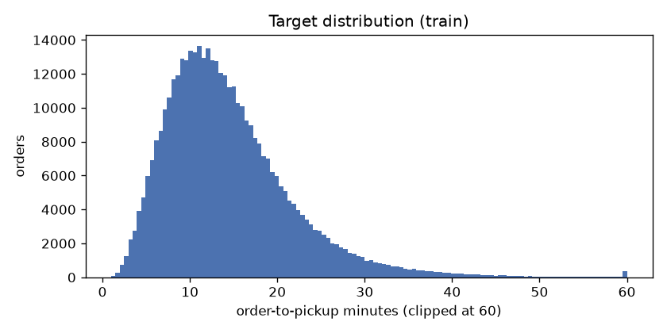
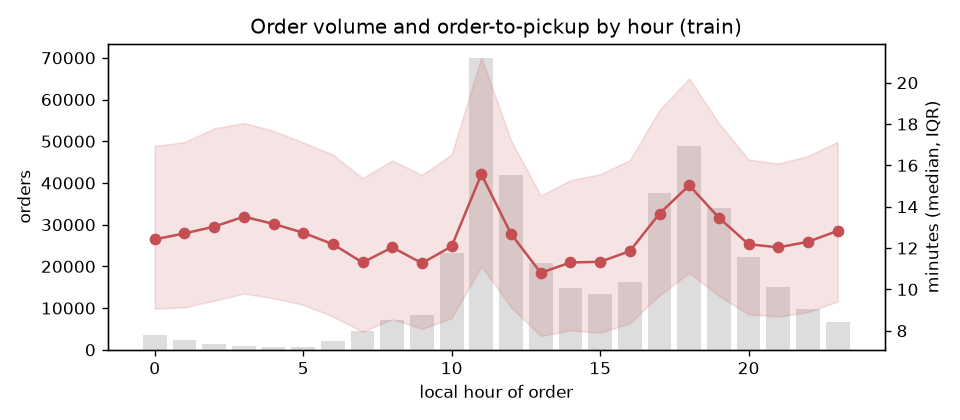
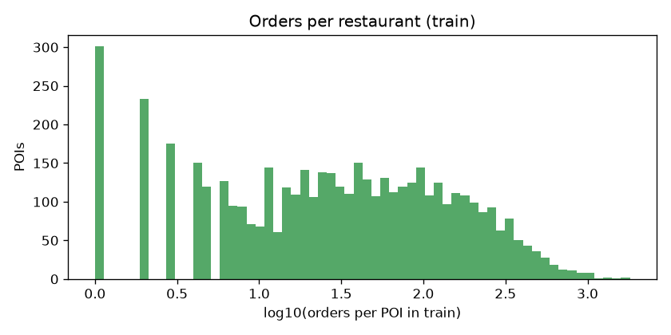
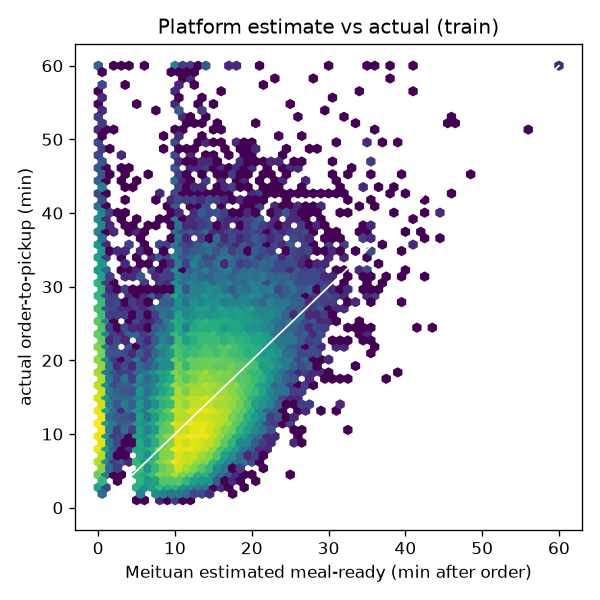

# EDA - Order-to-Pickup Time (train period only)

Rows: 406,481 orders · local dates 2022-10-16 .. 2022-10-22 · POIs: 4,825 · areas (da_id): 23

Target = minutes from order creation to rider pickup. It is NOT food preparation time and NOT rider waiting time.

## 1. Target distribution

```
count    406481.00
mean         14.44
std           7.39
min           1.00
5%            5.30
25%           9.32
50%          13.12
75%          17.95
95%          27.97
99%          38.87
max         117.68
```
Skewness: 1.63



## 2. Time of day

```
      orders  median    p25    p75
hour                              
0       3554   12.42   9.07  16.93
1       2292   12.71   9.13  17.12
2       1477   13.03   9.45  17.78
3        940   13.52   9.80  18.05
4        649   13.17   9.57  17.67
5        640   12.74   9.26  17.11
6       2169   12.18   8.68  16.52
7       4393   11.30   7.95  15.38
8       7234   12.03   8.57  16.23
9       8292   11.27   8.08  15.53
10     23165   12.08   8.62  16.53
11     69919   15.57  11.12  21.22
12     41909   12.68   9.13  17.20
13     20852   10.80   7.75  14.53
14     14812   11.30   8.02  15.28
15     13442   11.33   7.90  15.57
16     16275   11.85   8.37  16.24
17     37571   13.67   9.72  18.68
18     48959   15.03  10.80  20.21
19     34071   13.47   9.68  18.03
20     22296   12.18   8.80  16.28
21     15087   12.03   8.68  16.08
22      9898   12.30   8.90  16.45
23      6585   12.83   9.42  17.13
```

Variance explained by hour (eta²): 0.0527



## 3. Weekend vs weekday

```
             count   mean  median
is_weekend                       
0           331630  14.35   13.05
1            74851  14.85   13.47
```
Only 6 train days (Mon-Sat; the single train weekend day is Saturday). Weekday-level effects cannot be estimated reliably -> the model uses `is_weekend`, not day-of-week.

## 4. Restaurants (poi_id)

- POIs in train: 4,825; median orders/POI: 30; POIs with >= 30 orders: 2,437
- Variance explained by POI means (eta², in-sample, optimistic for small POIs): 0.2632
- Variance explained by area da_id (eta²): 0.0267



## 5. Meituan platform estimate (benchmark, NOT a feature)

- Available for 98.62% of train orders
- MAE of the estimate vs actual order-to-pickup on train: 6.094 min
- corr(estimate, actual): 0.221



## 6. Platform-side real-time signals (ablation only - RiderOS cannot observe these at inference)

Median target by number of open (not yet picked-up) orders at the same POI at t0:

```
                  count  median
poi_open_orders                
0                184496   12.25
1                 94464   12.88
2                 49192   13.63
3                 27278   14.35
4                 16242   14.98
5                 10094   15.55
6                  6741   16.03
7                  4628   16.30
8                  3163   16.47
9                  2258   16.81
10                 7925   18.62
```
- corr(target, poi_open_orders): 0.204
- corr(target, poi_orders_last_30m): 0.102
- corr(target, distance_km): 0.059
