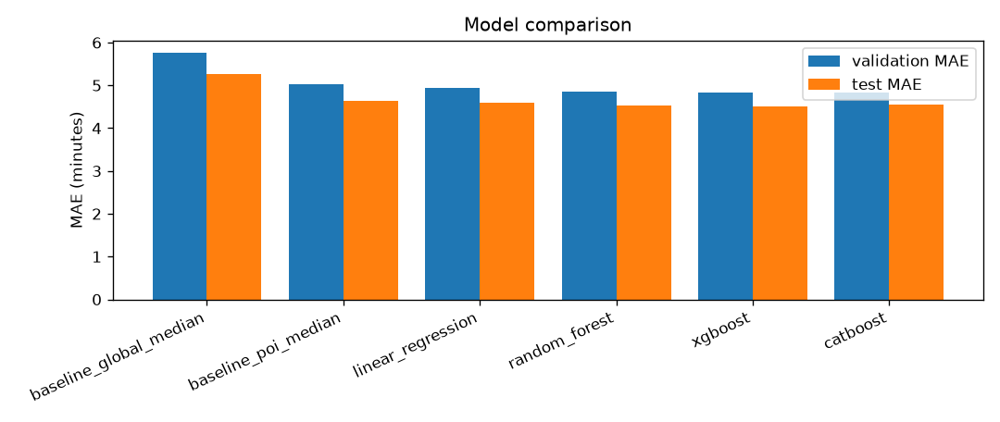
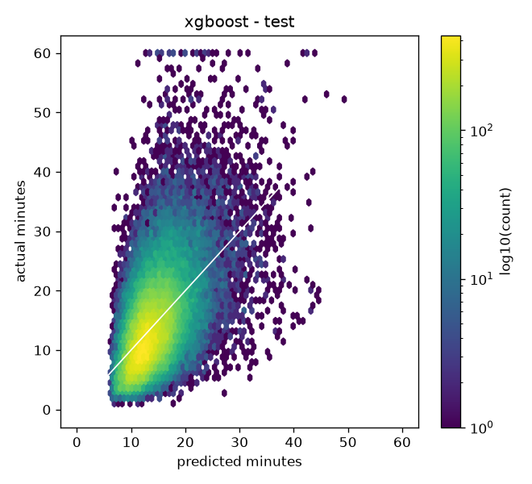
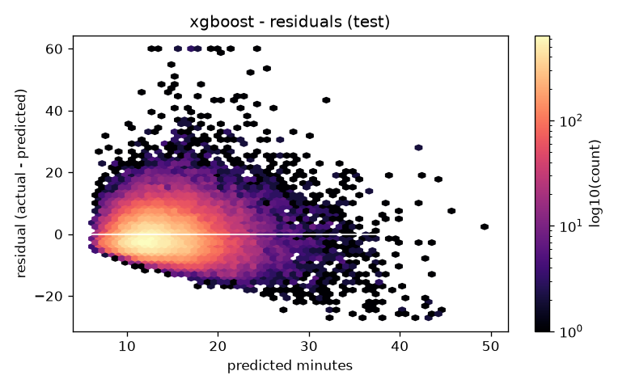
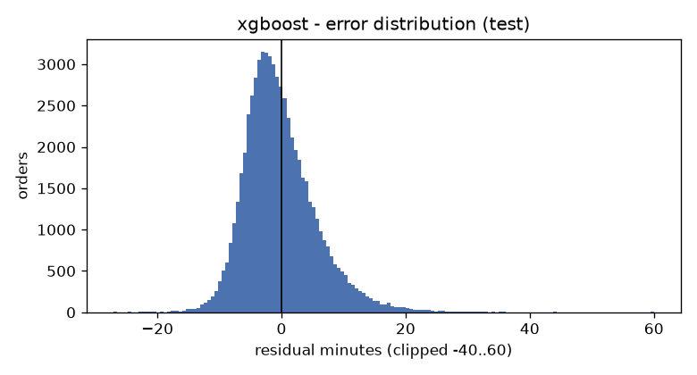
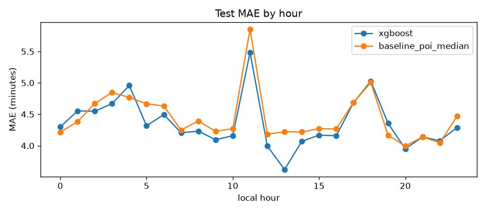

# Results - pickup_o2p 1.0.0

> All numbers below were produced by `rideros-ml train` on the Meituan INFORMS TSL data in this run.
> Target: **order-to-pickup minutes** (not food preparation time, not rider waiting time).

Split: train 406,481 · validation 75,044 (2022-10-23) · test 64,701 (2022-10-24)

Selected model: **xgboost** (lowest validation MAE among deployable models (baselines included)). Selection fixed at 2026-11-09T11:24:54+00:00, test evaluated at 2026-11-09T11:24:54+00:00.

## Model comparison

| Model | Features | Val MAE | Val RMSE | Val R² | Test MAE | Test RMSE | Test R² |
|---|---|---|---|---|---|---|---|
| baseline_global_median | deployable | 5.763 | 8.200 | -0.075 | 5.274 | 7.227 | -0.022 |
| baseline_poi_median | deployable | 5.030 | 7.186 | 0.174 | 4.636 | 6.399 | 0.199 |
| linear_regression | deployable | 4.942 | 6.817 | 0.257 | 4.601 | 6.155 | 0.259 |
| random_forest | deployable | 4.851 | 6.717 | 0.279 | 4.530 | 6.086 | 0.275 |
| **xgboost** | deployable | 4.822 | 6.664 | 0.290 | 4.509 | 6.061 | 0.281 |
| catboost | deployable | 4.841 | 6.710 | 0.280 | 4.559 | 6.112 | 0.269 |
| catboost_ablation_realtime | ablation (not deployable) | 4.769 | 6.566 | 0.311 | 4.479 | 6.011 | 0.293 |
| Meituan platform estimate (benchmark, not ours) | platform model | 6.553 | 9.536 | -0.491 | 6.002 | 8.534 | -0.452 |

Benchmark rows: estimate available for 98.67% (val) / 98.74% (test) of orders; metrics on that subset. The estimate predicts meal-ready time, a different quantity than order-to-pickup, so this comparison shows how well the platform's own number tracks pickup time - not a like-for-like model contest.



## Prediction interval (split conformal, calibrated on validation)

- Nominal coverage 80% · **empirical test coverage 81.6%** · mean width 14.95 min
- Coverage by restaurant training volume: 1-29: 77.9%, 100-499: 82.2%, 30-99: 81.1%, 500+: 81.7%, unseen in train: 65.1%

## Test error by segment (selected model)

| Segment | Group | n | MAE | RMSE | Bias |
|---|---|---|---|---|---|
| hour_band | 00-05 | 1,611 | 4.483 | 6.276 | 0.307 |
| hour_band | 06-10 | 7,074 | 4.178 | 5.717 | -0.071 |
| hour_band | 11-13 lunch | 21,338 | 4.727 | 6.301 | 0.148 |
| hour_band | 14-16 | 7,039 | 4.130 | 5.872 | 0.155 |
| hour_band | 17-20 dinner | 22,619 | 4.606 | 6.078 | 0.315 |
| hour_band | 21-23 | 5,020 | 4.149 | 5.577 | -0.242 |
| poi_train_orders | 1-29 | 4,131 | 4.939 | 6.758 | 0.042 |
| poi_train_orders | 100-499 | 37,484 | 4.434 | 5.935 | 0.132 |
| poi_train_orders | 30-99 | 11,336 | 4.532 | 6.001 | 0.160 |
| poi_train_orders | 500+ | 11,535 | 4.523 | 6.004 | 0.275 |
| poi_train_orders | unseen in train | 215 | 7.239 | 14.210 | 0.310 |

## Figures (test day, selected model)






## Tuning

- XGBoost: 20 Optuna trials, best val MAE 4.822, params `{"learning_rate": 0.03603204862011917, "max_depth": 9, "min_child_weight": 22.486878967166422, "subsample": 0.6384058554718893, "colsample_bytree": 0.7065425650425667, "reg_lambda": 6.890087897266931}`
- CatBoost: 15 Optuna trials, best val MAE 4.841, params `{"learning_rate": 0.09199661313775, "depth": 6, "l2_leaf_reg": 4.6578138187435485, "bagging_temperature": 0.629454868852057}`
- Random forest (fixed, not tuned): `{"n_estimators": 200, "min_samples_leaf": 20, "max_features": 0.6, "max_samples": 0.5}`
- Early stopping and tuning both use the validation day; the conformal calibration reuses it, so test coverage is the honest check.

## Leakage review

| Feature | Source | Known at t0 | Available to RiderOS at inference | Used |
|---|---|---|---|---|
| poi_id | order | yes | yes (dataset restaurant) | yes |
| da_id | first dispatched waybill (~13 s after t0) | yes (pushed with order) | yes (POI reference) | yes |
| hour / minute_sin / minute_cos | platform_order_time | yes | yes (request time) | yes |
| is_weekend | order date | yes | yes | yes |
| poi_orders_last_30m | orders at POI in [t0-30m, t0) | yes | no (no live platform data) | ablation only |
| da_orders_last_30m | orders in area in [t0-30m, t0) | yes | no | ablation only |
| poi_open_orders | orders at POI created < t0 and fetched > t0 | yes (state at t0) | no | ablation only |
| distance_km | sender/recipient coords | yes | no (rider rarely knows before accepting) | ablation only |
| estimate_meal_prepare_time | Meituan model output | yes | no | benchmark only |
| estimate_arrived_time | Meituan promise | yes | no | excluded |
| dispatch/grab/fetch/arrive times, courier_id, grab_lat/lng | post-assignment events | NO | no | excluded (leakage) |

## Run log

```
[    0.0s] split sizes train=406,481 val=75,044 test=64,701 quick=False
[    0.0s] baseline_global_median: val MAE=5.7633
[    0.1s] baseline_poi_median: val MAE=5.0296
[    1.9s] linear_regression: val MAE=4.9425
[   13.8s] random_forest: val MAE=4.8505
[  139.0s] xgboost tuning: 20 trials, best val MAE=4.8220
[  145.7s] xgboost: val MAE=4.8220
[ 1548.0s] catboost tuning: 15 trials, best val MAE=4.8410
[ 1656.0s] catboost: val MAE=4.8410
[ 1735.3s] catboost_ablation_realtime: val MAE=4.7694
[ 1735.3s] meituan platform estimate (benchmark): val MAE=6.5525 on 98.67% rows
[ 1735.4s] SELECTED (by val MAE): xgboost; conformal q_low=-6.389 q_high=8.559
[ 1736.4s] TEST xgboost: MAE=4.5088 R2=0.2813 interval coverage=0.816
```
